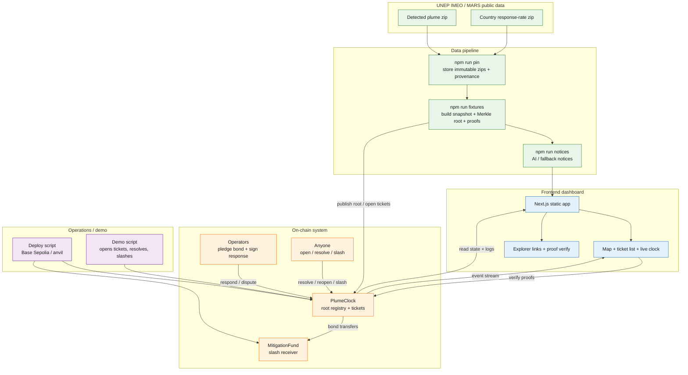
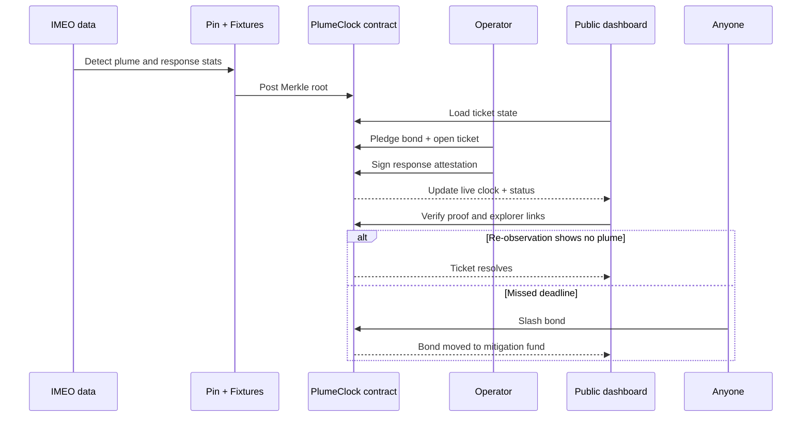

# PlumeClock architecture at a glance

## What this means

- Public IMEO/MARS methane alerts are pinned and provenance-checked.
- The data pipeline turns those records into a Merkle snapshot plus proofs.
- Smart contracts enforce ticket lifecycle: open, respond, resolve, reopen, slash.
- The dashboard reads on-chain state and displays it to the public in real time.
- Demo and deploy scripts replay the end-to-end flow without needing a real production operator.

## Simplified lifecycle

## File map

- `contracts/` — Solidity smart contracts
- `src/` — Next.js dashboard app
- `public/data/` — generated fixtures, proofs, notices
- `data/imeo/` — pinned IMEO source data and provenance
- `scripts/` — deploy, fixtures, demo automation
- `docs/` — architecture, security, impact documentation
- `demo/` — video/demo tooling and generated visuals

## One-line summary

PlumeClock turns public methane alerts into transparent on-chain tickets, and the whole project is a tight loop: public data → pinned snapshot → smart contracts → public dashboard → mitigation through slashing.
