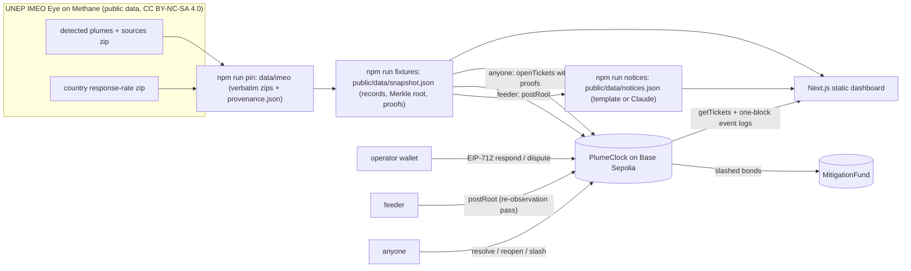
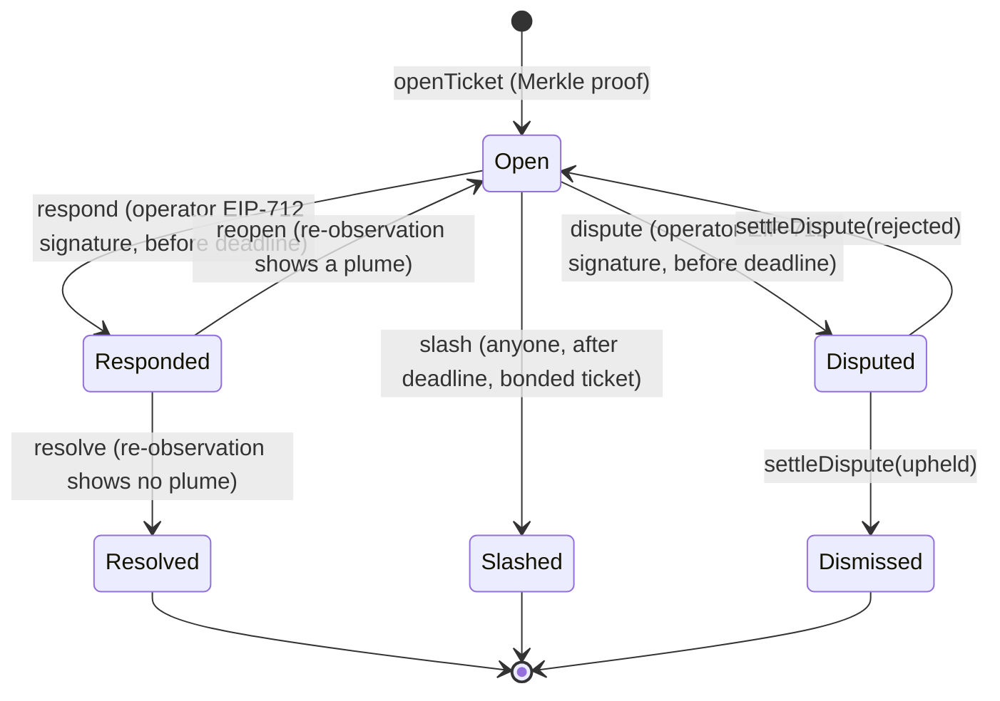

# PlumeClock architecture

PlumeClock turns satellite methane alerts from UNEP's International Methane Emissions Observatory
(IMEO) into on-chain tickets with a public response clock. This page is the architecture diagram and
technical specification; the full design record is
`docs/superpowers/specs/2026-10-15-plumeclock-design.md`.

## System diagram

## Data pipeline

1. `npm run pin` downloads IMEO's detected-plumes export and the country response-rate zip, stores
   them byte-for-byte in `data/imeo/`, and records URL, `Last-Modified`, size and SHA-256 in
   `data/imeo/provenance.json`. The download sends an honest `User-Agent`
   (`PlumeClock-snapshot-pin/0.1`), because the IMEO host rejects default library agents.
2. `npm run fixtures` re-verifies those hashes and parses the CSVs. The exact headers are asserted,
   so an upstream schema change stops the build instead of corrupting data.
3. The **universe** is every MARS-notified oil and gas source whose last plume has a quantified
   `ch4_fluxrate`. Each becomes one `SourceRecord`: IMEO fields verbatim, plus the last plume's rate,
   date and coordinates.
4. Each record is ABI-encoded as a Solidity tuple and double-hashed:
   `leaf = keccak256(keccak256(abi.encode(record)))`. Leaves are sorted and combined with
   OpenZeppelin-compatible sorted-pair hashing into one Merkle root. The same test vectors are
   asserted in the TypeScript suite (`test/merkle.test.ts`) and the Foundry suite
   (`contracts/test/PlumeBase.t.sol`).
5. The **ticket set** is the 40 highest-rate sources detected in the 12 months before the snapshot,
   plus the two demo sources picked by locked rules. It gets Merkle proofs and plume histories in
   `public/data/snapshot.json`.

## Smart contracts

| File | Responsibility |
|---|---|
| `contracts/src/PlumeTypes.sol` | enums, structs, custom errors, events |
| `contracts/src/PlumeBase.sol` | immutables, storage, root registry, leaf hashing, CO2e, read views |
| `contracts/src/PlumeBonds.sol` | `pledge` / `withdrawBond` (native testnet ETH, locked while a bonded ticket is active) |
| `contracts/src/PlumeTickets.sol` | `openTicket` / `openTickets` with Merkle proofs against a snapshot root |
| `contracts/src/PlumeResponses.sol` | EIP-712 `respond`, `dispute`, arbiter `settleDispute` |
| `contracts/src/PlumeReobservations.sol` | `resolve` / `reopen` from a proven re-observation |
| `contracts/src/PlumeClock.sol` | permissionless `slash` to the mitigation fund |
| `contracts/src/MitigationFund.sol` | receives slashed bonds; a named steward disburses them |

Roles are immutable constructor arguments. The **feeder** can only post Merkle roots. The **arbiter**
can only settle disputes. **Operators** opt in per source by pledging a bond. There is no admin key,
no upgrade path and no pause switch. The contracts use Solidity 0.8.28 and OpenZeppelin Contracts
5.4.0 (`EIP712`, `SignatureChecker`, `MerkleProof`, `ReentrancyGuard`).

## Ticket state machine

- The clock starts when a ticket opens: `deadline = openedAt + responseWindow`.
- A dispute pauses the clock. A rejected dispute resumes it with the time that was left.
- A re-observation must be newer than the response (`observedAt > respondedAt`) and proven against a
  re-observation root.
- After `MAX_REOPENS` (2) failed fixes, responses are refused, so the bond can only end slashed or
  dismissed.
- A slash sends the source's whole bond to the MitigationFund. It uses checks-effects-interactions
  plus a reentrancy guard.

## Dashboard

The Next.js app is a static export (`next build` → `out/`) that reads chain state straight from the
public RPC with viem. Nothing runs server-side.

- **Map layers:** world land (world-atlas), every universe source as a dot coloured by IMEO feedback,
  country response-rate bubbles, and ticket markers coloured by status.
- **Ticket list:** sorted by triage score.
- **Ticket panel:**
  - IMEO facts verbatim, with IMEO's own caveat on response rates.
  - CO2e "if it persists" (GWP100 29.8).
  - A live countdown, shown as a 30-day clock with the time-warp labelled.
  - The state history with an explorer link for every transition.
  - A **Verify** button: it recomputes the leaf, checks the proof, and confirms on-chain that the
    root was posted as a snapshot root.

## AI plume analyst

- Triage is a deterministic score: `impact × persistence × response history`, scaled to 0–100.
- `npm run notices` drafts each ticket's plain-language notice. With `LLM_API_KEY` set it calls the
  Anthropic Messages API (`claude-opus-5-5`, low effort, server-side refusal fallbacks), with a prompt
  that allows only the given facts. Without a key, or after any refusal, API error or invalid output,
  it falls back to deterministic template text.
- The model never changes scores, statuses or funds. Every notice records which generator wrote it.

## Deployment and demo

- **Deploy:** `npm run deploy -- --network base-sepolia` deploys MitigationFund and PlumeClock from the
  Foundry artifacts and writes `public/deployments/base-sepolia.json`. The file holds public
  addresses, the deploy block, the response window and the public RPC URL only.
- **Demo:** `npm run demo -- --network base-sepolia` runs the scenes:
  - Setup: bonds, the snapshot root, background tickets.
  - Scene 1: A's and B's tickets open.
  - Scene 2: A's signed attestation.
  - Scene 3: the replayed pass and A resolved.
  - Scene 4: B's deadline passes and B is slashed.
- **Local rehearsal:** the same runner works against a local anvil (`--network anvil`), where time is
  warped instead of waited. `test/e2e/demo.e2e.test.ts` runs it end to end.
- Testnet deploys and testnet demo runs are human-gated steps; agents never hold keys.

## Technical specification

| Parameter | Value |
|---|---|
| Chain | Base Sepolia (chain id 84532); local rehearsal on anvil (31337) |
| Explorer | Blockscout, `https://base-sepolia.blockscout.com` |
| Response window | 180 s on the demo deployment, shown as IMEO's 30-calendar-day feedback window |
| Minimum bond | 0.0005 ETH (testnet); demo bonds are 0.001 ETH |
| CO2e | `rate kg/h × 8,760 h × 29.8 / 1,000` t CO2e per year, if the emission persisted (IPCC AR6 GWP100, fossil CH4) |
| Ticket id | `keccak256(abi.encode(sourceId, lastPlumeAt))` |
| EIP-712 domain | name `PlumeClock`, version `1`, chain id, contract address |
| Data | UNEP IMEO Eye on Methane // GLOBAL, CC BY-NC-SA 4.0, pinned snapshot with SHA-256 provenance |
| Toolchain | Foundry 1.4, Node 22, Next.js 15.5, React 19.2, viem 2.56, vitest 3.2 |
