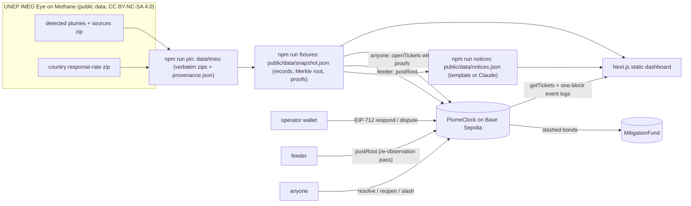
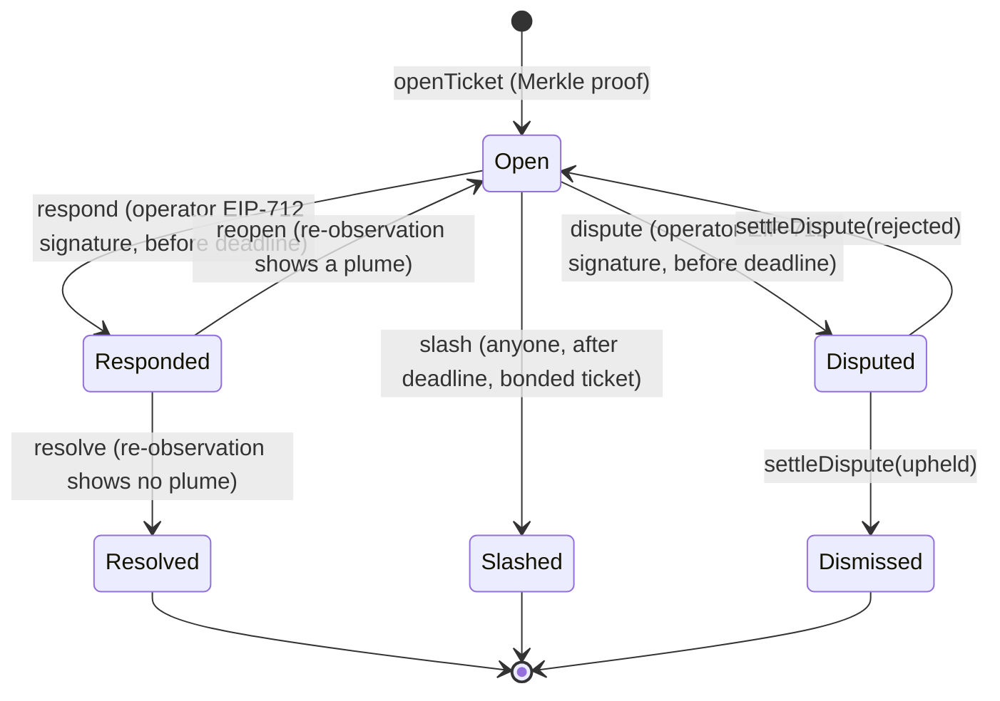

# PlumeClock Deploy, Demo and Docs Implementation Plan

**Goal:** Make the money shot runnable: EIP-712 signing, deployment, Blockscout verification and a scene runner proven end to end on anvil, then the human-gated Base Sepolia deploy and demo run, the judge-facing docs, and the README.
**Architecture:** viem scripts over shared libraries (eip712, actors, deploy, waiters, funding, checks, demo). anvil end-to-end tests spawn a throwaway node and use its unlocked accounts, so no key exists in code; testnet runs read burner keys from a git-ignored .env and are human-gated.
**Tech Stack:** TypeScript 5.9.3, Node 22, viem 2.56.9, Foundry 1.4.4 (anvil, forge verify-contract), Base Sepolia (84532) + Blockscout, vitest 3.2.7
**Source spec:** docs/superpowers/specs/2026-10-15-plumeclock-design.md

---

## How to read these tasks

- Run every command from the repository root. Commands work in Windows PowerShell and Git Bash; the README gate (Task 4.10 in the demo plan) is PowerShell-only.
- A code block introduced by "Create ... with exactly this content" is the complete file. Write it byte-for-byte; do not reformat or "improve" it. These files were compiled and tested together before this plan was written.
- Write every file as UTF-8 without a byte-order mark. Use your file-writing tool, not PowerShell 5.1's `Set-Content` or `Out-File`, which add a BOM (`JSON.parse` on a file read with `readFileSync` fails on it).
- `npm run check -- <files>` runs `tsc --noEmit` over the whole project, then vitest on the named files. Both must pass.
- Never run git. The orchestrator commits exactly the files listed under **Files:**.
- Tasks marked HUMAN-GATED are never executed by an executor: the orchestrator pauses them for the user or the gate-concierge.

### Task 4.1: EIP-712 typed data and actor wallets

**Files:**
- Create: `src/lib/eip712.ts`
- Create: `src/lib/actors.ts`
- Test:   `test/eip712.test.ts`

**Depends on:** Task 2.1
**Effort:** high
**Model tier:** top
**Provides:** `src/lib/eip712.ts: plumeClockDomain(chainId, verifyingContract), attestationTypedData(chainId, verifyingContract, message), disputeTypedData(chainId, verifyingContract, message); src/lib/actors.ts: Wallet, ActorWallets { deployer, feeder, operatorA, operatorB }, KEY_ENV_VARS, anvilActors(chain, rpcUrl), envActors(env, chain, rpcUrl)`
**Requires:** `src/lib/types.ts: SourceRecord, Reobservation, FeedbackLabel, Priority, Triage, SnapshotRecord, PlumeHistoryEntry, ResponseRate, ProvenanceFile, Provenance, SnapshotFile, Notice, NoticesFile, NetworkName, DeploymentActors, DeploymentFile`, `toolchain: package.json scripts (check, test:smoke, test:abi, test:e2e, verify:web, abi, pin, check:snapshot, fixtures, notices, deploy, verify:contracts, check:deployment, demo, check:demo) + foundry.toml (solc 0.8.28, src contracts/src, test contracts/test, out contracts/out)`

Typed data that must match Solidity exactly: domain `{ name: 'PlumeClock', version: '1', chainId, verifyingContract }`, `Attestation(bytes32 ticketId,string cause,string action,bytes32 evidenceHash)` and `DisputeClaim(bytes32 ticketId,string reason,bytes32 evidenceHash)`. Actors: anvil uses its unlocked accounts 0-3 through the node (no keys anywhere in code); testnet reads `DEPLOYER_PRIVATE_KEY`, `FEEDER_PRIVATE_KEY`, `OPERATOR_A_PRIVATE_KEY`, `OPERATOR_B_PRIVATE_KEY` from the environment and errors name the variable but never echo a value. Tests generate throwaway keys at runtime.

Upstream interfaces this task builds on (already committed by the tasks it depends on):

- `src/lib/types.ts: SourceRecord, Reobservation, FeedbackLabel, Priority, Triage, SnapshotRecord, PlumeHistoryEntry, ResponseRate, ProvenanceFile, Provenance, SnapshotFile, Notice, NoticesFile, NetworkName, DeploymentActors, DeploymentFile`
- `toolchain: package.json scripts (check, test:smoke, test:abi, test:e2e, verify:web, abi, pin, check:snapshot, fixtures, notices, deploy, verify:contracts, check:deployment, demo, check:demo) + foundry.toml (solc 0.8.28, src contracts/src, test contracts/test, out contracts/out)`

- [ ] **Step 1: Write the failing test**

Create `test/eip712.test.ts` with exactly this content:

````ts
import { describe, expect, it } from 'vitest';
import { recoverTypedDataAddress } from 'viem';
import { generatePrivateKey, privateKeyToAccount } from 'viem/accounts';
import { baseSepolia } from 'viem/chains';
import { KEY_ENV_VARS, envActors } from '../src/lib/actors';
import { attestationTypedData, disputeTypedData, plumeClockDomain } from '../src/lib/eip712';

const CONTRACT = '0x00000000000000000000000000000000000000c1';
const TICKET = '0x1111111111111111111111111111111111111111111111111111111111111111';

describe('EIP-712 typed data', () => {
  it('uses the PlumeClock v1 domain', () => {
    expect(plumeClockDomain(84532, CONTRACT)).toEqual({
      name: 'PlumeClock',
      version: '1',
      chainId: 84532,
      verifyingContract: CONTRACT,
    });
  });

  it('lists the Attestation and DisputeClaim fields in the Solidity typehash order', () => {
    const att = attestationTypedData(84532, CONTRACT, { ticketId: TICKET, cause: 'c', action: 'a', evidenceHash: TICKET });
    expect(att.primaryType).toBe('Attestation');
    expect(att.types.Attestation.map((f) => `${f.type} ${f.name}`).join(',')).toBe(
      'bytes32 ticketId,string cause,string action,bytes32 evidenceHash',
    );
    const dis = disputeTypedData(84532, CONTRACT, { ticketId: TICKET, reason: 'r', evidenceHash: TICKET });
    expect(dis.primaryType).toBe('DisputeClaim');
    expect(dis.types.DisputeClaim.map((f) => `${f.type} ${f.name}`).join(',')).toBe(
      'bytes32 ticketId,string reason,bytes32 evidenceHash',
    );
  });

  it('round-trips an operator signature', async () => {
    const account = privateKeyToAccount(generatePrivateKey());
    const typed = attestationTypedData(84532, CONTRACT, {
      ticketId: TICKET,
      cause: 'Pressure-relief valve stuck open',
      action: 'Valve replaced',
      evidenceHash: TICKET,
    });
    const signature = await account.signTypedData(typed);
    expect(await recoverTypedDataAddress({ ...typed, signature })).toBe(account.address);
  });
});

describe('envActors', () => {
  const keys = () => ({
    [KEY_ENV_VARS.deployer]: generatePrivateKey(),
    [KEY_ENV_VARS.feeder]: generatePrivateKey(),
    [KEY_ENV_VARS.operatorA]: generatePrivateKey(),
    [KEY_ENV_VARS.operatorB]: generatePrivateKey(),
  });

  it('builds four wallets from the named env vars', () => {
    const env = keys();
    const actors = envActors(env, baseSepolia, 'https://sepolia.base.org');
    expect(actors.feeder.account.address).toBe(privateKeyToAccount(env.FEEDER_PRIVATE_KEY as `0x${string}`).address);
    expect(actors.operatorB.chain.id).toBe(84532);
  });

  it('names a missing variable without printing any value', () => {
    const env = { ...keys(), OPERATOR_A_PRIVATE_KEY: undefined };
    expect(() => envActors(env, baseSepolia, 'https://sepolia.base.org')).toThrow(
      'Missing OPERATOR_A_PRIVATE_KEY (set it in the git-ignored .env file)',
    );
  });

  it('rejects a malformed key and never echoes it', () => {
    const bad = '0xnot-a-key-value-12345';
    const env = { ...keys(), DEPLOYER_PRIVATE_KEY: bad };
    let message = '';
    try {
      envActors(env, baseSepolia, 'https://sepolia.base.org');
    } catch (e) {
      message = (e as Error).message;
    }
    expect(message).toBe('DEPLOYER_PRIVATE_KEY must be a 0x-prefixed 32-byte hex private key');
    expect(message).not.toContain(bad);
  });
});
````

- [ ] **Step 2: Run to confirm it fails**
      Run: `npm run check -- test/eip712.test.ts`
      Expected: FAIL — tsc: Cannot find module '../src/lib/actors'

- [ ] **Step 3: Minimal implementation**

Create `src/lib/eip712.ts` with exactly this content:

````ts
import type { Hex } from 'viem';

/** Must match PlumeBase's EIP712("PlumeClock", "1") constructor. */
export function plumeClockDomain(chainId: number, verifyingContract: Hex) {
  return { name: 'PlumeClock', version: '1', chainId, verifyingContract } as const;
}

/** Must match PlumeResponses.ATTESTATION_TYPEHASH field order. */
export const attestationTypes = {
  Attestation: [
    { name: 'ticketId', type: 'bytes32' },
    { name: 'cause', type: 'string' },
    { name: 'action', type: 'string' },
    { name: 'evidenceHash', type: 'bytes32' },
  ],
} as const;

/** Must match PlumeResponses.DISPUTE_TYPEHASH field order. */
export const disputeTypes = {
  DisputeClaim: [
    { name: 'ticketId', type: 'bytes32' },
    { name: 'reason', type: 'string' },
    { name: 'evidenceHash', type: 'bytes32' },
  ],
} as const;

export interface AttestationMessage {
  ticketId: Hex;
  cause: string;
  action: string;
  evidenceHash: Hex;
}

export interface DisputeMessage {
  ticketId: Hex;
  reason: string;
  evidenceHash: Hex;
}

export function attestationTypedData(chainId: number, verifyingContract: Hex, message: AttestationMessage) {
  return {
    domain: plumeClockDomain(chainId, verifyingContract),
    types: attestationTypes,
    primaryType: 'Attestation' as const,
    message,
  };
}

export function disputeTypedData(chainId: number, verifyingContract: Hex, message: DisputeMessage) {
  return {
    domain: plumeClockDomain(chainId, verifyingContract),
    types: disputeTypes,
    primaryType: 'DisputeClaim' as const,
    message,
  };
}
````

Create `src/lib/actors.ts` with exactly this content:

````ts
import { createWalletClient, http, type Account, type Chain, type Hex, type Transport, type WalletClient } from 'viem';
import { privateKeyToAccount } from 'viem/accounts';

export type Wallet = WalletClient<Transport, Chain, Account>;

export interface ActorWallets {
  deployer: Wallet;
  feeder: Wallet;
  operatorA: Wallet;
  operatorB: Wallet;
}

/** Env var names (never values) the testnet scripts read. */
export const KEY_ENV_VARS = {
  deployer: 'DEPLOYER_PRIVATE_KEY',
  feeder: 'FEEDER_PRIVATE_KEY',
  operatorA: 'OPERATOR_A_PRIVATE_KEY',
  operatorB: 'OPERATOR_B_PRIVATE_KEY',
} as const;

function wallet(chain: Chain, rpcUrl: string, account: Account | Hex): Wallet {
  return createWalletClient({ chain, transport: http(rpcUrl), account }) as Wallet;
}

/** Anvil's unlocked default accounts 0..3, signing through the node (no keys in code). */
export async function anvilActors(chain: Chain, rpcUrl: string): Promise<ActorWallets> {
  const accounts = await createWalletClient({ chain, transport: http(rpcUrl) }).getAddresses();
  if (accounts.length < 4) throw new Error(`anvil exposes ${accounts.length} accounts; need 4`);
  return {
    deployer: wallet(chain, rpcUrl, accounts[0]),
    feeder: wallet(chain, rpcUrl, accounts[1]),
    operatorA: wallet(chain, rpcUrl, accounts[2]),
    operatorB: wallet(chain, rpcUrl, accounts[3]),
  };
}

/** Testnet actors from private keys in the environment; errors name the variable, never the value. */
export function envActors(env: Readonly<Record<string, string | undefined>>, chain: Chain, rpcUrl: string): ActorWallets {
  const load = (name: string): Account => {
    const value = env[name]?.trim();
    if (!value) throw new Error(`Missing ${name} (set it in the git-ignored .env file)`);
    if (!/^0x[0-9a-fA-F]{64}$/.test(value)) throw new Error(`${name} must be a 0x-prefixed 32-byte hex private key`);
    return privateKeyToAccount(value as Hex);
  };
  return {
    deployer: wallet(chain, rpcUrl, load(KEY_ENV_VARS.deployer)),
    feeder: wallet(chain, rpcUrl, load(KEY_ENV_VARS.feeder)),
    operatorA: wallet(chain, rpcUrl, load(KEY_ENV_VARS.operatorA)),
    operatorB: wallet(chain, rpcUrl, load(KEY_ENV_VARS.operatorB)),
  };
}
````

- [ ] **Step 4: Run to confirm it passes (gate)**
      Run: `npm run check -- test/eip712.test.ts`
      Expected: PASS — tsc prints no errors; vitest reports `Test Files  1 passed (1)` and `Tests  6 passed (6)`

- [ ] **Step 5: Commit (kernel-performed — no agent runs this)**
      The orchestrator re-runs the gate, scope-checks the worktree against **Files:**, and commits exactly
      those paths (plus lockfiles) with this message. Executors never run git.
      Message: `feat(demo): EIP-712 typed data and actor wallets`

### Task 4.2: Deploy library, waiters, funding and deployment check (anvil e2e)

**Files:**
- Create: `src/lib/deploy.ts`
- Create: `src/lib/waiters.ts`
- Create: `src/lib/funding.ts`
- Create: `src/lib/checkDeployment.ts`
- Create: `scripts/deploy.ts`
- Create: `scripts/check-deployment.ts`
- Test:   `test/e2e/deploy.e2e.test.ts`

**Depends on:** Task 1.10, Task 3.2, Task 4.1
**Effort:** high
**Model tier:** top
**Provides:** `src/lib/deploy.ts: deployPlumeClock(opts): Promise<DeploymentFile>, writeDeployment(file), readDeployment(network), readBytecode(contract); src/lib/waiters.ts: anvilWaiter(chain, rpcUrl), pollingWaiter(publicClient, log); src/lib/funding.ts: fundActors(publicClient, actors, bondWei, log); src/lib/checkDeployment.ts: checkDeployment(publicClient, deployment); npm run deploy; npm run check:deployment`
**Requires:** `src/lib/abi.generated.ts: export const plumeClockAbi, export const mitigationFundAbi (as const, generated from the Foundry artifacts)`, `src/lib/eip712.ts: plumeClockDomain(chainId, verifyingContract), attestationTypedData(chainId, verifyingContract, message), disputeTypedData(chainId, verifyingContract, message); src/lib/actors.ts: Wallet, ActorWallets { deployer, feeder, operatorA, operatorB }, KEY_ENV_VARS, anvilActors(chain, rpcUrl), envActors(env, chain, rpcUrl)`, `src/lib/chain.ts: networkConfig(name): NetworkConfig, txUrl(explorerUrl, hash), addressUrl; src/lib/format.ts: displayRemainingSeconds, formatClock, warpLabel, formatTonnes, formatRate, formatDate, shortAddress, decodeSourceId, formatEth; src/lib/status.ts: DisplayStatus, STATUS_LABELS, displayStatus(t, nowSeconds)`, `src/lib/types.ts: SourceRecord, Reobservation, FeedbackLabel, Priority, Triage, SnapshotRecord, PlumeHistoryEntry, ResponseRate, ProvenanceFile, Provenance, SnapshotFile, Notice, NoticesFile, NetworkName, DeploymentActors, DeploymentFile`

Deploys MitigationFund (steward = deployer) then PlumeClock (arbiter = deployer) from the Foundry artifacts with viem and returns the `DeploymentFile`. The file records the **public** RPC for base-sepolia, never `RPC_URL` (which may carry an API key). `checkDeployment` confirms code exists and every immutable matches the file. `scripts/deploy.ts --check` only prints each actor's address and balance (no transaction), for the human-gated deploy. The e2e test spawns its own anvil on port 8547 (`anvil` must be on PATH), deploys, checks, and kills anvil; it is a terminating command.

Upstream interfaces this task builds on (already committed by the tasks it depends on):

- `src/lib/abi.generated.ts: export const plumeClockAbi, export const mitigationFundAbi (as const, generated from the Foundry artifacts)`
- `src/lib/eip712.ts: plumeClockDomain(chainId, verifyingContract), attestationTypedData(chainId, verifyingContract, message), disputeTypedData(chainId, verifyingContract, message); src/lib/actors.ts: Wallet, ActorWallets { deployer, feeder, operatorA, operatorB }, KEY_ENV_VARS, anvilActors(chain, rpcUrl), envActors(env, chain, rpcUrl)`
- `src/lib/chain.ts: networkConfig(name): NetworkConfig, txUrl(explorerUrl, hash), addressUrl; src/lib/format.ts: displayRemainingSeconds, formatClock, warpLabel, formatTonnes, formatRate, formatDate, shortAddress, decodeSourceId, formatEth; src/lib/status.ts: DisplayStatus, STATUS_LABELS, displayStatus(t, nowSeconds)`
- `src/lib/types.ts: SourceRecord, Reobservation, FeedbackLabel, Priority, Triage, SnapshotRecord, PlumeHistoryEntry, ResponseRate, ProvenanceFile, Provenance, SnapshotFile, Notice, NoticesFile, NetworkName, DeploymentActors, DeploymentFile`

- [ ] **Step 1: Write the failing test**

Create `test/e2e/deploy.e2e.test.ts` with exactly this content:

````ts
import { spawn, type ChildProcess } from 'node:child_process';
import { createPublicClient, http, parseEther, type Chain, type PublicClient, type Transport } from 'viem';
import { foundry } from 'viem/chains';
import { afterAll, beforeAll, describe, expect, it } from 'vitest';
import { anvilActors } from '../../src/lib/actors';
import { checkDeployment } from '../../src/lib/checkDeployment';
import { deployPlumeClock } from '../../src/lib/deploy';
import { anvilWaiter } from '../../src/lib/waiters';

const PORT = 8547;
const RPC = `http://127.0.0.1:${PORT}`;
let anvil: ChildProcess | undefined;

async function waitForRpc(url: string, timeoutMs = 30_000): Promise<void> {
  const start = Date.now();
  while (Date.now() - start < timeoutMs) {
    try {
      const res = await fetch(url, {
        method: 'POST',
        headers: { 'content-type': 'application/json' },
        body: JSON.stringify({ jsonrpc: '2.0', id: 1, method: 'eth_chainId', params: [] }),
      });
      if (res.ok) return;
    } catch {
      // not listening yet
    }
    await new Promise((resolve) => setTimeout(resolve, 250));
  }
  throw new Error(`anvil did not start on ${url}`);
}

beforeAll(async () => {
  anvil = spawn('anvil', ['--port', String(PORT), '--silent'], { stdio: 'ignore' });
  await waitForRpc(RPC);
});

afterAll(() => {
  anvil?.kill();
});

describe('deployPlumeClock on anvil', () => {
  it('deploys both contracts with the requested immutables and passes checkDeployment', async () => {
    const publicClient = createPublicClient({ chain: foundry, transport: http(RPC) }) as PublicClient<Transport, Chain>;
    const actors = await anvilActors(foundry, RPC);
    const deployment = await deployPlumeClock({
      network: 'anvil',
      rpcUrl: RPC,
      publicClient,
      actors,
      responseWindowSeconds: 180,
      minBondWei: parseEther('0.0005'),
    });
    expect(deployment).toMatchObject({
      schema: 'plumeclock.deployment.v1',
      network: 'anvil',
      chainId: 31337,
      rpcUrl: RPC,
      explorerUrl: '',
      responseWindowSeconds: 180,
      minBondWei: '500000000000000',
    });
    expect(deployment.actors.arbiter).toBe(actors.deployer.account.address);
    expect(deployment.actors.feeder).toBe(actors.feeder.account.address);
    expect(await checkDeployment(publicClient, deployment)).toBe(
      `DEPLOYMENT OK anvil PlumeClock ${deployment.plumeClock} (response window 180 s)`,
    );
    await expect(checkDeployment(publicClient, { ...deployment, responseWindowSeconds: 60 })).rejects.toThrow(
      'Deployment file does not match chain: responseWindow',
    );
  });

  it('anvilWaiter moves chain time past a deadline', async () => {
    const publicClient = createPublicClient({ chain: foundry, transport: http(RPC) }) as PublicClient<Transport, Chain>;
    const before = Number((await publicClient.getBlock()).timestamp);
    await anvilWaiter(foundry, RPC)(before + 500);
    expect(Number((await publicClient.getBlock()).timestamp)).toBeGreaterThan(before + 500);
  });
});
````

- [ ] **Step 2: Run to confirm it fails**
      Run: `npm run test:e2e`
      Expected: FAIL — vitest cannot resolve `../../src/lib/deploy`

- [ ] **Step 3: Minimal implementation**

Create `src/lib/deploy.ts` with exactly this content:

````ts
import { mkdirSync, readFileSync, writeFileSync } from 'node:fs';
import { join } from 'node:path';
import type { Chain, Hex, PublicClient, Transport } from 'viem';
import { mitigationFundAbi, plumeClockAbi } from './abi.generated';
import type { ActorWallets } from './actors';
import { networkConfig } from './chain';
import type { DeploymentFile, NetworkName } from './types';

export const ARTIFACTS_DIR = 'contracts/out';
export const DEPLOYMENTS_DIR = 'public/deployments';

export function readBytecode(contract: 'PlumeClock' | 'MitigationFund', artifactsDir = ARTIFACTS_DIR): Hex {
  const path = join(artifactsDir, `${contract}.sol`, `${contract}.json`);
  const artifact = JSON.parse(readFileSync(path, 'utf8')) as { bytecode?: { object?: string } };
  const object = artifact.bytecode?.object;
  if (!object || !object.startsWith('0x') || object.length < 4) throw new Error(`No bytecode in ${path} (run forge build)`);
  return object as Hex;
}

export interface DeployOptions {
  network: NetworkName;
  rpcUrl: string;
  publicClient: PublicClient<Transport, Chain>;
  actors: ActorWallets;
  responseWindowSeconds: number;
  minBondWei: bigint;
  artifactsDir?: string;
}

/** Deploys MitigationFund (steward = deployer) then PlumeClock (arbiter = deployer). */
export async function deployPlumeClock(opts: DeployOptions): Promise<DeploymentFile> {
  const { publicClient, actors } = opts;
  const deployer = actors.deployer.account.address;
  const fundHash = await actors.deployer.deployContract({
    abi: mitigationFundAbi,
    bytecode: readBytecode('MitigationFund', opts.artifactsDir),
    args: [deployer],
  });
  const fundReceipt = await publicClient.waitForTransactionReceipt({ hash: fundHash });
  if (!fundReceipt.contractAddress) throw new Error('MitigationFund deployment returned no address');
  const clockHash = await actors.deployer.deployContract({
    abi: plumeClockAbi,
    bytecode: readBytecode('PlumeClock', opts.artifactsDir),
    args: [
      actors.feeder.account.address,
      deployer,
      fundReceipt.contractAddress,
      BigInt(opts.responseWindowSeconds),
      opts.minBondWei,
    ],
  });
  const clockReceipt = await publicClient.waitForTransactionReceipt({ hash: clockHash });
  if (!clockReceipt.contractAddress) throw new Error('PlumeClock deployment returned no address');
  const cfg = networkConfig(opts.network);
  return {
    schema: 'plumeclock.deployment.v1',
    network: opts.network,
    chainId: cfg.chain.id,
    rpcUrl: opts.network === 'anvil' ? opts.rpcUrl : cfg.rpcUrl,
    explorerUrl: cfg.explorerUrl,
    plumeClock: clockReceipt.contractAddress,
    mitigationFund: fundReceipt.contractAddress,
    deployBlock: Number(fundReceipt.blockNumber),
    responseWindowSeconds: opts.responseWindowSeconds,
    minBondWei: opts.minBondWei.toString(),
    actors: {
      deployer,
      feeder: actors.feeder.account.address,
      arbiter: deployer,
      operatorA: actors.operatorA.account.address,
      operatorB: actors.operatorB.account.address,
    },
    deployedAt: new Date().toISOString(),
  };
}

export function deploymentPath(network: NetworkName, dir = DEPLOYMENTS_DIR): string {
  return join(dir, `${network}.json`);
}

export function writeDeployment(file: DeploymentFile, dir = DEPLOYMENTS_DIR): string {
  mkdirSync(dir, { recursive: true });
  const path = deploymentPath(file.network, dir);
  writeFileSync(path, `${JSON.stringify(file, null, 2)}\n`);
  return path;
}

export function readDeployment(network: NetworkName, dir = DEPLOYMENTS_DIR): DeploymentFile {
  return JSON.parse(readFileSync(deploymentPath(network, dir), 'utf8')) as DeploymentFile;
}
````

Create `src/lib/waiters.ts` with exactly this content:

````ts
import { createPublicClient, createTestClient, http, type Chain, type PublicClient, type Transport } from 'viem';

function sleep(ms: number): Promise<void> {
  return new Promise((resolve) => setTimeout(resolve, ms));
}

/** anvil: jump chain time just past the deadline and mine a block. */
export function anvilWaiter(chain: Chain, rpcUrl: string): (deadline: number) => Promise<void> {
  const test = createTestClient({ chain, mode: 'anvil', transport: http(rpcUrl) });
  const pub = createPublicClient({ chain, transport: http(rpcUrl) });
  return async (deadline) => {
    const block = await pub.getBlock();
    const gap = deadline - Number(block.timestamp) + 1;
    if (gap > 0) await test.increaseTime({ seconds: gap });
    await test.mine({ blocks: 1 });
  };
}

/** Public testnet: wait in real time until the latest block is past the deadline. */
export function pollingWaiter(
  publicClient: PublicClient<Transport, Chain>,
  log: (line: string) => void,
  intervalMs = 5000,
): (deadline: number) => Promise<void> {
  return async (deadline) => {
    for (;;) {
      const block = await publicClient.getBlock();
      const left = deadline - Number(block.timestamp);
      if (left < 0) return;
      log(`  waiting for the deadline: ${left + 1} s of chain time left`);
      await sleep(Math.min(intervalMs, (left + 1) * 1000));
    }
  };
}
````

Create `src/lib/funding.ts` with exactly this content:

````ts
import { parseEther, type Chain, type PublicClient, type Transport } from 'viem';
import type { ActorWallets, Wallet } from './actors';

/** Testnet only: the deployer tops up feeder and operators from faucet ETH so the demo can run. */
export async function fundActors(
  publicClient: PublicClient<Transport, Chain>,
  actors: ActorWallets,
  bondWei: bigint,
  log: (line: string) => void,
): Promise<void> {
  const targets: [string, Wallet, bigint][] = [
    ['feeder', actors.feeder, parseEther('0.003')],
    ['operatorA', actors.operatorA, bondWei + parseEther('0.002')],
    ['operatorB', actors.operatorB, bondWei + parseEther('0.002')],
  ];
  for (const [name, wallet, target] of targets) {
    const balance = await publicClient.getBalance({ address: wallet.account.address });
    if (balance >= target) continue;
    const hash = await actors.deployer.sendTransaction({ to: wallet.account.address, value: target - balance });
    await publicClient.waitForTransactionReceipt({ hash });
    log(`  funded ${name} with ${target - balance} wei (${hash})`);
  }
}
````

Create `src/lib/checkDeployment.ts` with exactly this content:

````ts
import type { Chain, PublicClient, Transport } from 'viem';
import { mitigationFundAbi, plumeClockAbi } from './abi.generated';
import type { DeploymentFile } from './types';

function same(a: string, b: string): boolean {
  return a.toLowerCase() === b.toLowerCase();
}

/** Confirms both contracts exist and their immutables match the committed deployment file. */
export async function checkDeployment(
  publicClient: PublicClient<Transport, Chain>,
  deployment: DeploymentFile,
): Promise<string> {
  for (const [name, address] of [
    ['PlumeClock', deployment.plumeClock],
    ['MitigationFund', deployment.mitigationFund],
  ] as const) {
    const code = await publicClient.getCode({ address });
    if (!code || code === '0x') throw new Error(`No contract code for ${name} at ${address}`);
  }
  const read = <T>(functionName: 'feeder' | 'arbiter' | 'mitigationFund' | 'responseWindow' | 'minBond') =>
    publicClient.readContract({ address: deployment.plumeClock, abi: plumeClockAbi, functionName }) as Promise<T>;
  const [feeder, arbiter, fund, window, minBond] = await Promise.all([
    read<string>('feeder'),
    read<string>('arbiter'),
    read<string>('mitigationFund'),
    read<bigint>('responseWindow'),
    read<bigint>('minBond'),
  ]);
  const steward = (await publicClient.readContract({
    address: deployment.mitigationFund,
    abi: mitigationFundAbi,
    functionName: 'steward',
  })) as string;
  const mismatches: string[] = [];
  if (!same(feeder, deployment.actors.feeder)) mismatches.push('feeder');
  if (!same(arbiter, deployment.actors.arbiter)) mismatches.push('arbiter');
  if (!same(fund, deployment.mitigationFund)) mismatches.push('mitigationFund');
  if (Number(window) !== deployment.responseWindowSeconds) mismatches.push('responseWindow');
  if (minBond.toString() !== deployment.minBondWei) mismatches.push('minBond');
  if (!same(steward, deployment.actors.deployer)) mismatches.push('steward');
  if (mismatches.length > 0) throw new Error(`Deployment file does not match chain: ${mismatches.join(', ')}`);
  return `DEPLOYMENT OK ${deployment.network} PlumeClock ${deployment.plumeClock} (response window ${window} s)`;
}
````

Create `scripts/deploy.ts` with exactly this content:

````ts
import { parseArgs } from 'node:util';
import { createPublicClient, formatEther, http, type Chain, type PublicClient, type Transport } from 'viem';
import { KEY_ENV_VARS, anvilActors, envActors } from '../src/lib/actors';
import { networkConfig } from '../src/lib/chain';
import { deployPlumeClock, writeDeployment } from '../src/lib/deploy';

// Usage: npm run deploy -- --network anvil|base-sepolia           (base-sepolia reads keys from .env)
//        npm run deploy -- --network base-sepolia --check   (prints actor addresses and balances, sends nothing)
const { values } = parseArgs({
  options: { network: { type: 'string', default: 'anvil' }, check: { type: 'boolean', default: false } },
});
const cfg = networkConfig(String(values.network));
if (cfg.name !== 'anvil') {
  try {
    process.loadEnvFile('.env');
  } catch {
    // keys may already be in the environment
  }
}
const rpcUrl = cfg.name === 'anvil' ? cfg.rpcUrl : process.env.RPC_URL?.trim() || cfg.rpcUrl;
const publicClient = createPublicClient({ chain: cfg.chain, transport: http(rpcUrl) }) as PublicClient<Transport, Chain>;
const actors = cfg.name === 'anvil' ? await anvilActors(cfg.chain, rpcUrl) : envActors(process.env, cfg.chain, rpcUrl);
if (values.check) {
  for (const role of Object.keys(KEY_ENV_VARS) as (keyof typeof KEY_ENV_VARS)[]) {
    const address = actors[role].account.address;
    const balance = await publicClient.getBalance({ address });
    console.log(`${role.padEnd(9)} ${address} ${formatEther(balance)} ETH`);
  }
} else {
  const deployment = await deployPlumeClock({
    network: cfg.name,
    rpcUrl,
    publicClient,
    actors,
    responseWindowSeconds: Number(process.env.RESPONSE_WINDOW_SECONDS ?? '180'),
    minBondWei: BigInt(process.env.MIN_BOND_WEI ?? '500000000000000'),
  });
  const path = writeDeployment(deployment);
  console.log(
    `DEPLOYED PlumeClock ${deployment.plumeClock} MitigationFund ${deployment.mitigationFund} on ${cfg.name} ` +
      `(block ${deployment.deployBlock}) -> ${path}`,
  );
}
````

Create `scripts/check-deployment.ts` with exactly this content:

````ts
import { parseArgs } from 'node:util';
import { createPublicClient, http, type Chain, type PublicClient, type Transport } from 'viem';
import { networkConfig } from '../src/lib/chain';
import { checkDeployment } from '../src/lib/checkDeployment';
import { readDeployment } from '../src/lib/deploy';

// Usage: npm run check:deployment -- --network anvil|base-sepolia
const { values } = parseArgs({ options: { network: { type: 'string', default: 'base-sepolia' } } });
const cfg = networkConfig(String(values.network));
const deployment = readDeployment(cfg.name);
const rpcUrl = cfg.name === 'anvil' ? deployment.rpcUrl : process.env.RPC_URL?.trim() || cfg.rpcUrl;
const publicClient = createPublicClient({ chain: cfg.chain, transport: http(rpcUrl) }) as PublicClient<Transport, Chain>;
console.log(await checkDeployment(publicClient, deployment));
````

- [ ] **Step 4: Run to confirm it passes (gate)**
      Run: `npm run test:e2e`
      Expected: PASS — `Test Files  1 passed (1)` and `Tests  2 passed (2)`

- [ ] **Step 5: Commit (kernel-performed — no agent runs this)**
      The orchestrator re-runs the gate, scope-checks the worktree against **Files:**, and commits exactly
      those paths (plus lockfiles) with this message. Executors never run git.
      Message: `feat(demo): deploy library and deployment check`

### Task 4.3: Blockscout verification command builder

**Files:**
- Create: `src/lib/verifyCommands.ts`
- Create: `scripts/verify-contracts.ts`
- Test:   `test/verifyCommands.test.ts`

**Depends on:** Task 4.2
**Effort:** low
**Model tier:** standard
**Provides:** `src/lib/verifyCommands.ts: verifyCommands(deployment, rpcUrl): string[][]; npm run verify:contracts`
**Requires:** `src/lib/deploy.ts: deployPlumeClock(opts): Promise<DeploymentFile>, writeDeployment(file), readDeployment(network), readBytecode(contract); src/lib/waiters.ts: anvilWaiter(chain, rpcUrl), pollingWaiter(publicClient, log); src/lib/funding.ts: fundActors(publicClient, actors, bondWei, log); src/lib/checkDeployment.ts: checkDeployment(publicClient, deployment); npm run deploy; npm run check:deployment`, `src/lib/types.ts: SourceRecord, Reobservation, FeedbackLabel, Priority, Triage, SnapshotRecord, PlumeHistoryEntry, ResponseRate, ProvenanceFile, Provenance, SnapshotFile, Notice, NoticesFile, NetworkName, DeploymentActors, DeploymentFile`

`npm run verify:contracts` verifies the committed Base Sepolia deployment on Blockscout (no API key) with `forge verify-contract ... --guess-constructor-args --verifier blockscout --verifier-url https://base-sepolia.blockscout.com/api/ --watch` (flags confirmed on forge 1.4.4). Only the pure argument builder is unit-tested here; running it is part of the human-gated deploy (Task 4.5).

Upstream interfaces this task builds on (already committed by the tasks it depends on):

- `src/lib/deploy.ts: deployPlumeClock(opts): Promise<DeploymentFile>, writeDeployment(file), readDeployment(network), readBytecode(contract); src/lib/waiters.ts: anvilWaiter(chain, rpcUrl), pollingWaiter(publicClient, log); src/lib/funding.ts: fundActors(publicClient, actors, bondWei, log); src/lib/checkDeployment.ts: checkDeployment(publicClient, deployment); npm run deploy; npm run check:deployment`
- `src/lib/types.ts: SourceRecord, Reobservation, FeedbackLabel, Priority, Triage, SnapshotRecord, PlumeHistoryEntry, ResponseRate, ProvenanceFile, Provenance, SnapshotFile, Notice, NoticesFile, NetworkName, DeploymentActors, DeploymentFile`

- [ ] **Step 1: Write the failing test**

Create `test/verifyCommands.test.ts` with exactly this content:

````ts
import { describe, expect, it } from 'vitest';
import type { DeploymentFile } from '../src/lib/types';
import { verifyCommands } from '../src/lib/verifyCommands';

const DEPLOYMENT: DeploymentFile = {
  schema: 'plumeclock.deployment.v1',
  network: 'base-sepolia',
  chainId: 84532,
  rpcUrl: 'https://sepolia.base.org',
  explorerUrl: 'https://base-sepolia.blockscout.com',
  plumeClock: '0x00000000000000000000000000000000000000c1',
  mitigationFund: '0x00000000000000000000000000000000000000f1',
  deployBlock: 1,
  responseWindowSeconds: 180,
  minBondWei: '500000000000000',
  actors: {
    deployer: '0x00000000000000000000000000000000000000d1',
    feeder: '0x00000000000000000000000000000000000000e1',
    arbiter: '0x00000000000000000000000000000000000000d1',
    operatorA: '0x00000000000000000000000000000000000000a1',
    operatorB: '0x00000000000000000000000000000000000000b2',
  },
  deployedAt: '2026-10-20T10:00:00.000Z',
};

describe('verifyCommands', () => {
  it('builds Blockscout forge verify-contract calls that read constructor args from the chain', () => {
    expect(verifyCommands(DEPLOYMENT, 'https://sepolia.base.org')).toEqual([
      [
        'verify-contract',
        '0x00000000000000000000000000000000000000c1',
        'contracts/src/PlumeClock.sol:PlumeClock',
        '--chain',
        '84532',
        '--rpc-url',
        'https://sepolia.base.org',
        '--guess-constructor-args',
        '--verifier',
        'blockscout',
        '--verifier-url',
        'https://base-sepolia.blockscout.com/api/',
        '--watch',
      ],
      [
        'verify-contract',
        '0x00000000000000000000000000000000000000f1',
        'contracts/src/MitigationFund.sol:MitigationFund',
        '--chain',
        '84532',
        '--rpc-url',
        'https://sepolia.base.org',
        '--guess-constructor-args',
        '--verifier',
        'blockscout',
        '--verifier-url',
        'https://base-sepolia.blockscout.com/api/',
        '--watch',
      ],
    ]);
  });

  it('refuses networks without a Blockscout setup', () => {
    expect(() => verifyCommands({ ...DEPLOYMENT, network: 'anvil' }, 'http://127.0.0.1:8545')).toThrow(
      'only set up for base-sepolia',
    );
  });
});
````

- [ ] **Step 2: Run to confirm it fails**
      Run: `npm run check -- test/verifyCommands.test.ts`
      Expected: FAIL — tsc: Cannot find module '../src/lib/verifyCommands'

- [ ] **Step 3: Minimal implementation**

Create `src/lib/verifyCommands.ts` with exactly this content:

````ts
import type { DeploymentFile } from './types';

export const BLOCKSCOUT_VERIFIER_URL = 'https://base-sepolia.blockscout.com/api/';

/** `forge verify-contract` argument lists for both contracts; constructor args are read from the chain. */
export function verifyCommands(deployment: DeploymentFile, rpcUrl: string): string[][] {
  if (deployment.network !== 'base-sepolia') throw new Error('Blockscout verification is only set up for base-sepolia');
  return [
    [deployment.plumeClock, 'contracts/src/PlumeClock.sol:PlumeClock'],
    [deployment.mitigationFund, 'contracts/src/MitigationFund.sol:MitigationFund'],
  ].map(([address, contract]) => [
    'verify-contract',
    address,
    contract,
    '--chain',
    String(deployment.chainId),
    '--rpc-url',
    rpcUrl,
    '--guess-constructor-args',
    '--verifier',
    'blockscout',
    '--verifier-url',
    BLOCKSCOUT_VERIFIER_URL,
    '--watch',
  ]);
}
````

Create `scripts/verify-contracts.ts` with exactly this content:

````ts
import { spawnSync } from 'node:child_process';
import { networkConfig } from '../src/lib/chain';
import { readDeployment } from '../src/lib/deploy';
import { verifyCommands } from '../src/lib/verifyCommands';

// Usage: npm run verify:contracts   (verifies the committed Base Sepolia deployment on Blockscout)
const cfg = networkConfig('base-sepolia');
const deployment = readDeployment('base-sepolia');
let failed = 0;
for (const args of verifyCommands(deployment, cfg.rpcUrl)) {
  console.log(`forge ${args.join(' ')}`);
  const result = spawnSync('forge', args, { stdio: 'inherit' });
  if (result.status !== 0) failed++;
}
if (failed > 0) {
  console.error(`${failed} verification(s) failed; re-run npm run verify:contracts`);
  process.exit(1);
}
console.log('VERIFIED on Blockscout');
````

- [ ] **Step 4: Run to confirm it passes (gate)**
      Run: `npm run check -- test/verifyCommands.test.ts`
      Expected: PASS — tsc prints no errors; vitest reports `Test Files  1 passed (1)` and `Tests  2 passed (2)`

- [ ] **Step 5: Commit (kernel-performed — no agent runs this)**
      The orchestrator re-runs the gate, scope-checks the worktree against **Files:**, and commits exactly
      those paths (plus lockfiles) with this message. Executors never run git.
      Message: `feat(demo): Blockscout verification commands`

### Task 4.4: Demo runner: the money shot end to end on anvil

**Files:**
- Create: `src/lib/demo.ts`
- Create: `src/lib/checkDemo.ts`
- Create: `scripts/demo.ts`
- Create: `scripts/check-demo.ts`
- Test:   `test/e2e/demo.e2e.test.ts`

**Depends on:** Task 2.2, Task 2.9, Task 3.3, Task 4.1, Task 4.2
**Effort:** high
**Model tier:** top
**Provides:** `src/lib/demo.ts: runDemo(ctx: DemoContext): Promise<DemoRun>, DemoRun, ticketIdFor(sourceId, lastPlumeAt), replayedObservations(records, observedAt, referenceDate); src/lib/checkDemo.ts: checkDemoRun(publicClient, deployment, run); npm run demo; npm run check:demo`
**Requires:** `src/lib/deploy.ts: deployPlumeClock(opts): Promise<DeploymentFile>, writeDeployment(file), readDeployment(network), readBytecode(contract); src/lib/waiters.ts: anvilWaiter(chain, rpcUrl), pollingWaiter(publicClient, log); src/lib/funding.ts: fundActors(publicClient, actors, bondWei, log); src/lib/checkDeployment.ts: checkDeployment(publicClient, deployment); npm run deploy; npm run check:deployment`, `src/lib/eip712.ts: plumeClockDomain(chainId, verifyingContract), attestationTypedData(chainId, verifyingContract, message), disputeTypedData(chainId, verifyingContract, message); src/lib/actors.ts: Wallet, ActorWallets { deployer, feeder, operatorA, operatorB }, KEY_ENV_VARS, anvilActors(chain, rpcUrl), envActors(env, chain, rpcUrl)`, `src/lib/merkle.ts: sourceIdFromName(name): Hex; hashSourceRecord(rec: SourceRecord): Hex; hashReobservation(obs: Reobservation): Hex; toAbiSourceRecord(rec); toAbiReobservation(obs); buildTree(leaves): MerkleTree; getProof(tree, leaf): Hex[]; verifyProof(leaf, proof, root): boolean`, `src/lib/readModel.ts: TicketView, RawTicket, ReadClient, toTicketView, makeReadClient(chain, rpcUrl), fetchTickets(client, address), fetchBondAmount, fetchResponseWindow, fetchRootKind, fetchTransitions(client, address, ticketId): TransitionEvent[], verifyRecord(record, proof, root, rootKindOnChain): Verification, recomputeRoot`, `public/data/snapshot.json (schema plumeclock.snapshot.v1, built from the pinned snapshot)`, `src/lib/abi.generated.ts: export const plumeClockAbi, export const mitigationFundAbi (as const, generated from the Foundry artifacts)`

Runs the scenes from spec §8 against a deployment and the committed snapshot. Setup: operators A and B pledge, the feeder posts the snapshot root and opens the background tickets in batches of 10. Scene 1 opens A's and B's tickets. Scene 2 is A's EIP-712 attestation. Scene 3: the feeder posts a replayed re-observation root (IMEO persistency: persistent/frequent -> plume, absent/sporadic -> none, undetermined omitted) and A resolves. Scene 4 waits past B's deadline and slashes B. Every tx prints its explorer link; the CLI writes `public/deployments/<network>.demo.json` (anvil files are git-ignored). The e2e test runs it all on its own anvil (port 8546) against the real committed snapshot.

Upstream interfaces this task builds on (already committed by the tasks it depends on):

- `src/lib/deploy.ts: deployPlumeClock(opts): Promise<DeploymentFile>, writeDeployment(file), readDeployment(network), readBytecode(contract); src/lib/waiters.ts: anvilWaiter(chain, rpcUrl), pollingWaiter(publicClient, log); src/lib/funding.ts: fundActors(publicClient, actors, bondWei, log); src/lib/checkDeployment.ts: checkDeployment(publicClient, deployment); npm run deploy; npm run check:deployment`
- `src/lib/eip712.ts: plumeClockDomain(chainId, verifyingContract), attestationTypedData(chainId, verifyingContract, message), disputeTypedData(chainId, verifyingContract, message); src/lib/actors.ts: Wallet, ActorWallets { deployer, feeder, operatorA, operatorB }, KEY_ENV_VARS, anvilActors(chain, rpcUrl), envActors(env, chain, rpcUrl)`
- `src/lib/merkle.ts: sourceIdFromName(name): Hex; hashSourceRecord(rec: SourceRecord): Hex; hashReobservation(obs: Reobservation): Hex; toAbiSourceRecord(rec); toAbiReobservation(obs); buildTree(leaves): MerkleTree; getProof(tree, leaf): Hex[]; verifyProof(leaf, proof, root): boolean`
- `src/lib/readModel.ts: TicketView, RawTicket, ReadClient, toTicketView, makeReadClient(chain, rpcUrl), fetchTickets(client, address), fetchBondAmount, fetchResponseWindow, fetchRootKind, fetchTransitions(client, address, ticketId): TransitionEvent[], verifyRecord(record, proof, root, rootKindOnChain): Verification, recomputeRoot`
- `public/data/snapshot.json (schema plumeclock.snapshot.v1, built from the pinned snapshot)`
- `src/lib/abi.generated.ts: export const plumeClockAbi, export const mitigationFundAbi (as const, generated from the Foundry artifacts)`

- [ ] **Step 1: Write the failing test**

Create `test/e2e/demo.e2e.test.ts` with exactly this content:

````ts
import { spawn, type ChildProcess } from 'node:child_process';
import { readFileSync } from 'node:fs';
import { createPublicClient, http, parseEther, type Chain, type PublicClient, type Transport } from 'viem';
import { foundry } from 'viem/chains';
import { afterAll, beforeAll, describe, expect, it } from 'vitest';
import { mitigationFundAbi } from '../../src/lib/abi.generated';
import { anvilActors } from '../../src/lib/actors';
import { checkDemoRun } from '../../src/lib/checkDemo';
import { deployPlumeClock } from '../../src/lib/deploy';
import { runDemo } from '../../src/lib/demo';
import { fetchTickets, fetchTransitions } from '../../src/lib/readModel';
import type { SnapshotFile } from '../../src/lib/types';
import { anvilWaiter } from '../../src/lib/waiters';

const PORT = 8546;
const RPC = `http://127.0.0.1:${PORT}`;
const ZERO = '0x0000000000000000000000000000000000000000';
let anvil: ChildProcess | undefined;

async function waitForRpc(url: string, timeoutMs = 30_000): Promise<void> {
  const start = Date.now();
  while (Date.now() - start < timeoutMs) {
    try {
      const res = await fetch(url, {
        method: 'POST',
        headers: { 'content-type': 'application/json' },
        body: JSON.stringify({ jsonrpc: '2.0', id: 1, method: 'eth_chainId', params: [] }),
      });
      if (res.ok) return;
    } catch {
      // not listening yet
    }
    await new Promise((resolve) => setTimeout(resolve, 250));
  }
  throw new Error(`anvil did not start on ${url}`);
}

beforeAll(async () => {
  anvil = spawn('anvil', ['--port', String(PORT), '--silent'], { stdio: 'ignore' });
  await waitForRpc(RPC);
});

afterAll(() => {
  anvil?.kill();
});

describe('PlumeClock money shot on a local anvil chain', () => {
  it('opens real IMEO tickets, resolves operator A, slashes operator B into the fund', async () => {
    const publicClient = createPublicClient({ chain: foundry, transport: http(RPC) }) as PublicClient<Transport, Chain>;
    const actors = await anvilActors(foundry, RPC);
    const deployment = await deployPlumeClock({
      network: 'anvil',
      rpcUrl: RPC,
      publicClient,
      actors,
      responseWindowSeconds: 180,
      minBondWei: parseEther('0.0005'),
    });
    const snapshot = JSON.parse(readFileSync('public/data/snapshot.json', 'utf8')) as SnapshotFile;
    const lines: string[] = [];
    const run = await runDemo({
      publicClient,
      deployment,
      snapshot,
      actors,
      bondWei: parseEther('0.001'),
      waitForDeadline: anvilWaiter(foundry, RPC),
      log: (line) => lines.push(line),
    });

    const tickets = await fetchTickets(publicClient, deployment.plumeClock);
    expect(tickets).toHaveLength(snapshot.ticketSet.length);
    const a = tickets.find((t) => t.id === run.tickets.operatorA);
    const b = tickets.find((t) => t.id === run.tickets.operatorB);
    expect(a?.sourceName).toBe(snapshot.scenario.operatorA);
    expect(a?.status).toBe(3);
    expect(b?.sourceName).toBe(snapshot.scenario.operatorB);
    expect(b?.status).toBe(4);
    expect(b?.slashedAmount).toBe(parseEther('0.001'));
    for (const t of tickets.filter((x) => x.id !== a?.id && x.id !== b?.id)) {
      expect(t.status).toBe(1);
      expect(t.operator).toBe(ZERO);
    }
    expect(await publicClient.getBalance({ address: deployment.mitigationFund })).toBe(parseEther('0.001'));
    expect(
      await publicClient.readContract({
        address: deployment.mitigationFund,
        abi: mitigationFundAbi,
        functionName: 'totalReceived',
      }),
    ).toBe(parseEther('0.001'));
    const eventsA = await fetchTransitions(publicClient, deployment.plumeClock, run.tickets.operatorA);
    expect(eventsA.map((e) => e.eventName)).toEqual(['TicketOpened', 'Responded', 'Resolved']);
    const eventsB = await fetchTransitions(publicClient, deployment.plumeClock, run.tickets.operatorB);
    expect(eventsB.map((e) => e.eventName)).toEqual(['TicketOpened', 'Slashed']);
    expect(run.txs.filter((t) => t.scene === '4')).toHaveLength(1);
    expect(lines.some((l) => l.startsWith('Scene 4'))).toBe(true);
    expect(await checkDemoRun(publicClient, deployment, run)).toBe(
      `DEMO RUN OK ${snapshot.scenario.operatorA} resolved, ${snapshot.scenario.operatorB} slashed (0.001 ETH to the fund)`,
    );
  });
});
````

- [ ] **Step 2: Run to confirm it fails**
      Run: `npm run test:e2e`
      Expected: FAIL — vitest cannot resolve `../../src/lib/demo` (the deploy e2e file still passes)

- [ ] **Step 3: Minimal implementation**

Create `src/lib/demo.ts` with exactly this content:

````ts
import { encodeAbiParameters, keccak256, toHex, type Chain, type Hex, type PublicClient, type Transport } from 'viem';
import { plumeClockAbi } from './abi.generated';
import type { ActorWallets } from './actors';
import { txUrl } from './chain';
import { attestationTypedData } from './eip712';
import { buildTree, getProof, hashReobservation, toAbiReobservation, toAbiSourceRecord } from './merkle';
import type { DeploymentFile, Reobservation, SnapshotFile, SnapshotRecord } from './types';

export const SNAPSHOT_ROOT_KIND = 1;
export const REOBSERVATION_ROOT_KIND = 2;
export const OPEN_BATCH = 10;

export interface DemoTx {
  scene: string;
  label: string;
  hash: Hex;
  url: string | null;
}

export interface DemoRun {
  schema: 'plumeclock.demo-run.v1';
  network: string;
  plumeClock: Hex;
  snapshotRoot: Hex;
  reobservationRoot: Hex;
  tickets: { operatorA: Hex; operatorB: Hex };
  scenario: { operatorA: string; operatorB: string };
  txs: DemoTx[];
  finishedAt: string;
}

export interface DemoContext {
  publicClient: PublicClient<Transport, Chain>;
  deployment: DeploymentFile;
  snapshot: SnapshotFile;
  actors: ActorWallets;
  bondWei: bigint;
  /** Resolves once chain time is past `deadline` (anvil: warp; testnet: wait). */
  waitForDeadline: (deadline: number) => Promise<void>;
  log: (line: string) => void;
  pauseMs?: number;
}

export function ticketIdFor(sourceId: Hex, lastPlumeAt: number): Hex {
  return keccak256(encodeAbiParameters([{ type: 'bytes32' }, { type: 'uint64' }], [sourceId, BigInt(lastPlumeAt)]));
}

/** Replayed pass from IMEO persistency: persistent/frequent = plume, absent/sporadic = none, undetermined omitted. */
export function replayedObservations(
  records: readonly SnapshotRecord[],
  observedAt: number,
  referenceDate: string,
): Reobservation[] {
  const out: Reobservation[] = [];
  for (const r of records) {
    const category = r.persistency.toLowerCase();
    if (category === 'undetermined') continue;
    out.push({
      sourceId: r.sourceId,
      observedAt,
      plumeDetected: category === 'persistent' || category === 'frequent',
      basis: `IMEO persistency_category=${r.persistency} (snapshot ${referenceDate}); replayed for the demo`,
    });
  }
  return out;
}

function recordFor(snapshot: SnapshotFile, sourceName: string): SnapshotRecord {
  const rec = snapshot.records.find((r) => r.sourceName === sourceName);
  if (!rec) throw new Error(`Snapshot has no record ${sourceName}`);
  return rec;
}

function sleep(ms: number): Promise<void> {
  return new Promise((resolve) => setTimeout(resolve, ms));
}

/** Runs setup + the four money-shot scenes against a fresh deployment. */
export async function runDemo(ctx: DemoContext): Promise<DemoRun> {
  const { publicClient, deployment, snapshot, actors, log } = ctx;
  const address = deployment.plumeClock;
  const txs: DemoTx[] = [];

  const confirm = async (scene: string, label: string, hash: Hex) => {
    const receipt = await publicClient.waitForTransactionReceipt({ hash });
    if (receipt.status !== 'success') throw new Error(`${label} reverted (${hash})`);
    const url = txUrl(deployment.explorerUrl, hash);
    txs.push({ scene, label, hash, url });
    log(`  [${scene}] ${label}: ${url ?? hash}`);
  };
  const pause = async () => {
    if (ctx.pauseMs && ctx.pauseMs > 0) await sleep(ctx.pauseMs);
  };

  const a = recordFor(snapshot, snapshot.scenario.operatorA);
  const b = recordFor(snapshot, snapshot.scenario.operatorB);
  const ticketA = ticketIdFor(a.sourceId, a.lastPlumeAt);
  const ticketB = ticketIdFor(b.sourceId, b.lastPlumeAt);
  const plumesSha = snapshot.provenance.files.find((f) => f.name.includes('plumes'))?.sha256 ?? 'unknown';

  log('Setup: operators pledge bonds, the feeder posts the IMEO snapshot root, background tickets open');
  await confirm(
    'setup',
    `Operator A pledges for ${a.sourceName}`,
    await actors.operatorA.writeContract({
      address,
      abi: plumeClockAbi,
      functionName: 'pledge',
      args: [a.sourceId],
      value: ctx.bondWei,
    }),
  );
  await confirm(
    'setup',
    `Operator B pledges for ${b.sourceName}`,
    await actors.operatorB.writeContract({
      address,
      abi: plumeClockAbi,
      functionName: 'pledge',
      args: [b.sourceId],
      value: ctx.bondWei,
    }),
  );
  await confirm(
    'setup',
    `Feeder posts snapshot root (${snapshot.universeCount} IMEO records)`,
    await actors.feeder.writeContract({
      address,
      abi: plumeClockAbi,
      functionName: 'postRoot',
      args: [snapshot.root, SNAPSHOT_ROOT_KIND, `plumeclock:imeo:${snapshot.referenceDate}:sha256=${plumesSha}`],
    }),
  );
  const background = snapshot.ticketSet
    .filter((n) => n !== a.sourceName && n !== b.sourceName)
    .map((n) => recordFor(snapshot, n));
  for (let i = 0; i < background.length; i += OPEN_BATCH) {
    const batch = background.slice(i, i + OPEN_BATCH);
    await confirm(
      'setup',
      `Open ${batch.length} background tickets`,
      await actors.feeder.writeContract({
        address,
        abi: plumeClockAbi,
        functionName: 'openTickets',
        args: [snapshot.root, batch.map(toAbiSourceRecord), batch.map((r) => snapshot.proofs[r.sourceName])],
      }),
    );
  }
  await pause();

  log(`Scene 1: real super-emitters ${a.sourceName} and ${b.sourceName} open tickets with a 30-day clock`);
  await confirm(
    '1',
    `Open tickets for ${a.sourceName} and ${b.sourceName}`,
    await actors.feeder.writeContract({
      address,
      abi: plumeClockAbi,
      functionName: 'openTickets',
      args: [
        snapshot.root,
        [toAbiSourceRecord(a), toAbiSourceRecord(b)],
        [snapshot.proofs[a.sourceName], snapshot.proofs[b.sourceName]],
      ],
    }),
  );
  await pause();

  log(`Scene 2: Operator A signs an EIP-712 repair attestation for ${a.sourceName}`);
  const message = {
    ticketId: ticketA,
    cause: 'Pressure-relief valve stuck open (simulated operator statement)',
    action: 'Valve replaced and line re-pressurised (simulated operator statement)',
    evidenceHash: keccak256(toHex(`PlumeClock demo evidence for ${a.sourceName}`)),
  };
  const signature = await actors.operatorA.signTypedData(attestationTypedData(deployment.chainId, address, message));
  await confirm(
    '2',
    `Operator A responds to ${a.sourceName}`,
    await actors.operatorA.writeContract({
      address,
      abi: plumeClockAbi,
      functionName: 'respond',
      args: [ticketA, message, signature],
    }),
  );
  await pause();

  log(`Scene 3: the replayed satellite pass shows no plume at ${a.sourceName}; the ticket resolves`);
  const responded = await publicClient.readContract({
    address,
    abi: plumeClockAbi,
    functionName: 'getTicket',
    args: [ticketA],
  });
  const latest = await publicClient.getBlock();
  const observedAt = Math.max(Number(responded.respondedAt) + 1, Number(latest.timestamp));
  const observations = replayedObservations(
    snapshot.ticketSet.map((n) => recordFor(snapshot, n)),
    observedAt,
    snapshot.referenceDate,
  );
  const obsA = observations.find((o) => o.sourceId === a.sourceId);
  if (!obsA || obsA.plumeDetected) throw new Error(`Replay for ${a.sourceName} must show no plume`);
  const obsTree = buildTree(observations.map(hashReobservation));
  await confirm(
    '3',
    `Feeder posts replayed re-observation root (${observations.length} sources)`,
    await actors.feeder.writeContract({
      address,
      abi: plumeClockAbi,
      functionName: 'postRoot',
      args: [obsTree.root, REOBSERVATION_ROOT_KIND, `plumeclock:replay:${snapshot.referenceDate}`],
    }),
  );
  await confirm(
    '3',
    `Resolve ${a.sourceName} (no plume on re-observation)`,
    await actors.feeder.writeContract({
      address,
      abi: plumeClockAbi,
      functionName: 'resolve',
      args: [ticketA, obsTree.root, toAbiReobservation(obsA), getProof(obsTree, hashReobservation(obsA))],
    }),
  );
  await pause();

  log('Scene 4: Operator B stays silent; when the clock hits zero anyone can slash');
  const silent = await publicClient.readContract({
    address,
    abi: plumeClockAbi,
    functionName: 'getTicket',
    args: [ticketB],
  });
  await ctx.waitForDeadline(Number(silent.deadline));
  await confirm(
    '4',
    `Slash ${b.sourceName}: bond to the mitigation fund`,
    await actors.feeder.writeContract({ address, abi: plumeClockAbi, functionName: 'slash', args: [ticketB] }),
  );

  return {
    schema: 'plumeclock.demo-run.v1',
    network: deployment.network,
    plumeClock: address,
    snapshotRoot: snapshot.root,
    reobservationRoot: obsTree.root,
    tickets: { operatorA: ticketA, operatorB: ticketB },
    scenario: snapshot.scenario,
    txs,
    finishedAt: new Date().toISOString(),
  };
}
````

Create `src/lib/checkDemo.ts` with exactly this content:

````ts
import { formatEther, type Chain, type PublicClient, type Transport } from 'viem';
import { plumeClockAbi } from './abi.generated';
import type { DemoRun } from './demo';
import type { DeploymentFile } from './types';

function same(a: string, b: string): boolean {
  return a.toLowerCase() === b.toLowerCase();
}

/** Confirms a recorded demo run left operator A resolved and operator B slashed into the fund. */
export async function checkDemoRun(
  publicClient: PublicClient<Transport, Chain>,
  deployment: DeploymentFile,
  run: DemoRun,
): Promise<string> {
  if (!same(run.plumeClock, deployment.plumeClock)) throw new Error('Demo run used a different PlumeClock deployment');
  const scenes = new Set(run.txs.map((t) => t.scene));
  for (const scene of ['setup', '1', '2', '3', '4']) {
    if (!scenes.has(scene)) throw new Error(`Demo run is missing scene ${scene}`);
  }
  const getTicket = (id: `0x${string}`) =>
    publicClient.readContract({ address: deployment.plumeClock, abi: plumeClockAbi, functionName: 'getTicket', args: [id] });
  const [a, b] = await Promise.all([getTicket(run.tickets.operatorA), getTicket(run.tickets.operatorB)]);
  if (a.status !== 3) throw new Error(`Operator A ticket is status ${a.status}, expected 3 (Resolved)`);
  if (b.status !== 4) throw new Error(`Operator B ticket is status ${b.status}, expected 4 (Slashed)`);
  const fundBalance = await publicClient.getBalance({ address: deployment.mitigationFund });
  if (fundBalance < b.slashedAmount) throw new Error('Mitigation fund holds less than the slashed bond');
  return `DEMO RUN OK ${run.scenario.operatorA} resolved, ${run.scenario.operatorB} slashed (${formatEther(b.slashedAmount)} ETH to the fund)`;
}
````

Create `scripts/demo.ts` with exactly this content:

````ts
import { readFileSync, writeFileSync } from 'node:fs';
import { parseArgs } from 'node:util';
import { createPublicClient, http, type Chain, type PublicClient, type Transport } from 'viem';
import { anvilActors, envActors } from '../src/lib/actors';
import { networkConfig } from '../src/lib/chain';
import { deployPlumeClock, readDeployment, writeDeployment } from '../src/lib/deploy';
import { runDemo } from '../src/lib/demo';
import { fundActors } from '../src/lib/funding';
import type { DeploymentFile, SnapshotFile } from '../src/lib/types';
import { anvilWaiter, pollingWaiter } from '../src/lib/waiters';

// Usage: npm run demo -- --network anvil|base-sepolia [--deploy] [--fund] [--pause 4000]
const { values } = parseArgs({
  options: {
    network: { type: 'string', default: 'anvil' },
    deploy: { type: 'boolean', default: false },
    fund: { type: 'boolean', default: false },
    pause: { type: 'string', default: '0' },
  },
});
const cfg = networkConfig(String(values.network));
if (cfg.name !== 'anvil') {
  try {
    process.loadEnvFile('.env');
  } catch {
    // keys may already be in the environment
  }
}
const log = (line: string) => console.log(line);
const rpcUrl = cfg.name === 'anvil' ? cfg.rpcUrl : process.env.RPC_URL?.trim() || cfg.rpcUrl;
const publicClient = createPublicClient({ chain: cfg.chain, transport: http(rpcUrl) }) as PublicClient<Transport, Chain>;
const actors = cfg.name === 'anvil' ? await anvilActors(cfg.chain, rpcUrl) : envActors(process.env, cfg.chain, rpcUrl);
const bondWei = BigInt(process.env.DEMO_BOND_WEI ?? '1000000000000000');
if (values.fund && cfg.name !== 'anvil') await fundActors(publicClient, actors, bondWei, log);
let deployment: DeploymentFile;
if (values.deploy) {
  deployment = await deployPlumeClock({
    network: cfg.name,
    rpcUrl,
    publicClient,
    actors,
    responseWindowSeconds: Number(process.env.RESPONSE_WINDOW_SECONDS ?? '180'),
    minBondWei: BigInt(process.env.MIN_BOND_WEI ?? '500000000000000'),
  });
  log(`Deployed PlumeClock ${deployment.plumeClock} -> ${writeDeployment(deployment)}`);
} else {
  deployment = readDeployment(cfg.name);
}
const snapshot = JSON.parse(readFileSync('public/data/snapshot.json', 'utf8')) as SnapshotFile;
const run = await runDemo({
  publicClient,
  deployment,
  snapshot,
  actors,
  bondWei,
  waitForDeadline: cfg.name === 'anvil' ? anvilWaiter(cfg.chain, rpcUrl) : pollingWaiter(publicClient, log),
  log,
  pauseMs: Number(values.pause),
});
const out = `public/deployments/${cfg.name}.demo.json`;
writeFileSync(out, `${JSON.stringify(run, null, 2)}\n`);
log(`DEMO OK ${run.txs.length} transactions -> ${out}`);
````

Create `scripts/check-demo.ts` with exactly this content:

````ts
import { readFileSync } from 'node:fs';
import { parseArgs } from 'node:util';
import { createPublicClient, http, type Chain, type PublicClient, type Transport } from 'viem';
import { networkConfig } from '../src/lib/chain';
import { checkDemoRun } from '../src/lib/checkDemo';
import { readDeployment } from '../src/lib/deploy';
import type { DemoRun } from '../src/lib/demo';

// Usage: npm run check:demo -- --network anvil|base-sepolia
const { values } = parseArgs({ options: { network: { type: 'string', default: 'base-sepolia' } } });
const cfg = networkConfig(String(values.network));
const deployment = readDeployment(cfg.name);
const run = JSON.parse(readFileSync(`public/deployments/${cfg.name}.demo.json`, 'utf8')) as DemoRun;
const rpcUrl = cfg.name === 'anvil' ? deployment.rpcUrl : process.env.RPC_URL?.trim() || cfg.rpcUrl;
const publicClient = createPublicClient({ chain: cfg.chain, transport: http(rpcUrl) }) as PublicClient<Transport, Chain>;
console.log(await checkDemoRun(publicClient, deployment, run));
````

- [ ] **Step 4: Run to confirm it passes (gate)**
      Run: `npm run test:e2e`
      Expected: PASS — `Test Files  2 passed (2)` and `Tests  3 passed (3)`

- [ ] **Step 5: Commit (kernel-performed — no agent runs this)**
      The orchestrator re-runs the gate, scope-checks the worktree against **Files:**, and commits exactly
      those paths (plus lockfiles) with this message. Executors never run git.
      Message: `feat(demo): money-shot demo runner with anvil e2e`

### Task 4.5: Deploy to Base Sepolia and verify on Blockscout (human-gated)

**Files:**
- Create: `public/deployments/base-sepolia.json`

**Depends on:** Task 4.2, Task 4.3
**Effort:** medium
**Model tier:** top
**Provides:** `public/deployments/base-sepolia.json (Base Sepolia PlumeClock + MitigationFund addresses)`
**Requires:** `src/lib/deploy.ts: deployPlumeClock(opts): Promise<DeploymentFile>, writeDeployment(file), readDeployment(network), readBytecode(contract); src/lib/waiters.ts: anvilWaiter(chain, rpcUrl), pollingWaiter(publicClient, log); src/lib/funding.ts: fundActors(publicClient, actors, bondWei, log); src/lib/checkDeployment.ts: checkDeployment(publicClient, deployment); npm run deploy; npm run check:deployment`, `src/lib/verifyCommands.ts: verifyCommands(deployment, rpcUrl): string[][]; npm run verify:contracts`

HUMAN-GATED (deploy, uses testnet keys). Run by the user or the gate-concierge on their go, never by an executor. Testnet only: Base Sepolia, chain id 84532.

Upstream interfaces this task builds on (already committed by the tasks it depends on):

- `src/lib/deploy.ts: deployPlumeClock(opts): Promise<DeploymentFile>, writeDeployment(file), readDeployment(network), readBytecode(contract); src/lib/waiters.ts: anvilWaiter(chain, rpcUrl), pollingWaiter(publicClient, log); src/lib/funding.ts: fundActors(publicClient, actors, bondWei, log); src/lib/checkDeployment.ts: checkDeployment(publicClient, deployment); npm run deploy; npm run check:deployment`
- `src/lib/verifyCommands.ts: verifyCommands(deployment, rpcUrl): string[][]; npm run verify:contracts`

- [ ] **Step 1: Prerequisites (human)**
      Create `.env` from `.env.example` with four **fresh testnet burner keys** (for example `cast wallet new` four times) for `DEPLOYER_PRIVATE_KEY`, `FEEDER_PRIVATE_KEY`, `OPERATOR_A_PRIVATE_KEY`, `OPERATOR_B_PRIVATE_KEY`. Never paste keys into chat or commit `.env`. Only the deployer needs faucet ETH (at least 0.02 Base Sepolia ETH): the demo's `--fund` tops up the other three from it. The gate-concierge runs the faucet claim from the kit's faucet library (`references/faucets/`; it has no `base-sepolia.md` entry yet, so expect a discovery pass). Skip faucets gated on a mainnet balance, which a fresh burner cannot pass. The Coinbase Developer Platform faucet is a candidate to try first (not verified here).

- [ ] **Step 2: Build the contracts (the deploy reads the git-ignored Foundry artifacts)**
      Run: `forge build`
      Expected: `Compiler run successful` (or `No files changed, compilation skipped` when the artifacts are already current)

- [ ] **Step 3: Check the actor addresses and balances**
      Run: `npm run deploy -- --network base-sepolia --check`
      Expected: four lines, `deployer`, `feeder`, `operatorA` and `operatorB`, each with its address and balance; nothing is sent. The deployer must show at least 0.02 ETH; if it shows less, stop and fund it first.

- [ ] **Step 4: Deploy**
      Run: `npm run deploy -- --network base-sepolia`
      Expected: `DEPLOYED PlumeClock 0x... MitigationFund 0x... on base-sepolia (block ...) -> public\deployments\base-sepolia.json`

- [ ] **Step 5: Verify the sources on Blockscout**
      Run: `npm run verify:contracts`
      Expected: `VERIFIED on Blockscout` (if Blockscout has not indexed the contracts yet, wait a minute and re-run)

- [ ] **Step 6: Run to confirm it passes (gate)**
      Run: `npm run check:deployment -- --network base-sepolia`
      Expected: PASS — `DEPLOYMENT OK base-sepolia PlumeClock 0x... (response window 180 s)`

- [ ] **Step 7: Commit (kernel-performed — no agent runs this)**
      The orchestrator re-runs the gate, scope-checks the worktree against **Files:**, and commits exactly
      those paths (plus lockfiles) with this message. Executors never run git.
      Message: `chore(deploy): record Base Sepolia deployment`

### Task 4.6: Run the demo on Base Sepolia (human-gated)

**Files:**
- Create: `public/deployments/base-sepolia.demo.json`
- Modify: `public/deployments/base-sepolia.json`

**Depends on:** Task 4.4, Task 4.5
**Effort:** medium
**Model tier:** top
**Provides:** `public/deployments/base-sepolia.demo.json (recorded Base Sepolia demo run with tx hashes)`
**Requires:** `src/lib/demo.ts: runDemo(ctx: DemoContext): Promise<DemoRun>, DemoRun, ticketIdFor(sourceId, lastPlumeAt), replayedObservations(records, observedAt, referenceDate); src/lib/checkDemo.ts: checkDemoRun(publicClient, deployment, run); npm run demo; npm run check:demo`, `public/deployments/base-sepolia.json (Base Sepolia PlumeClock + MitigationFund addresses)`

HUMAN-GATED (wallet: bonds move and keys sign). A rehearsal on the real testnet before recording, and the source of the committed explorer links. The 180 s response window is real chain time on a testnet (no time warp), so the run takes about 5 minutes; most of it is the wait for operator B's deadline. `public/deployments/base-sepolia.json` changes only if the recovery step below redeploys. For the recorded video, demo-studio later runs `npm run demo -- --network base-sepolia --deploy` on a fresh deployment.

Upstream interfaces this task builds on (already committed by the tasks it depends on):

- `src/lib/demo.ts: runDemo(ctx: DemoContext): Promise<DemoRun>, DemoRun, ticketIdFor(sourceId, lastPlumeAt), replayedObservations(records, observedAt, referenceDate); src/lib/checkDemo.ts: checkDemoRun(publicClient, deployment, run); npm run demo; npm run check:demo`
- `public/deployments/base-sepolia.json (Base Sepolia PlumeClock + MitigationFund addresses)`

- [ ] **Step 1: Prerequisites (human)**
      Task 4.5's `public/deployments/base-sepolia.json` is committed and `.env` still holds the four burner keys; the deployer has at least 0.015 ETH left (`npm run deploy -- --network base-sepolia --check`).

- [ ] **Step 2: Run the scenes**
      Run: `npm run demo -- --network base-sepolia --fund --pause 3000`
      Expected: the Setup and Scene 1-4 log lines, each tx with a `https://base-sepolia.blockscout.com/tx/0x...` link, a few `waiting for the deadline` lines, then `DEMO OK 12 transactions -> public/deployments/base-sepolia.demo.json` (the count is 8 + ceil(background tickets / 10))

- [ ] **Step 3: Recovery, only if the run stopped partway**
      A half-finished run cannot be resumed: its tickets are already open on chain. Start over on a fresh deployment instead.
      Run: `npm run demo -- --network base-sepolia --deploy --fund --pause 3000`
      Expected: any `funded ...` lines, then `Deployed PlumeClock 0x... -> public\deployments\base-sepolia.json` (the file is rewritten), then the same scene log as above. Then re-run `npm run verify:contracts` (Expected: `VERIFIED on Blockscout`) before the gate.

- [ ] **Step 4: Run to confirm it passes (gate)**
      Run: `npm run check:demo -- --network base-sepolia`
      Expected: PASS — `DEMO RUN OK <operator A source> resolved, <operator B source> slashed (0.001 ETH to the fund)`

- [ ] **Step 5: Commit (kernel-performed — no agent runs this)**
      The orchestrator re-runs the gate, scope-checks the worktree against **Files:**, and commits exactly
      those paths (plus lockfiles) with this message. Executors never run git.
      Message: `chore(demo): record Base Sepolia demo run`

### Task 4.7: Architecture and technical specification doc

**Files:**
- Create: `docs/architecture.md`
- Test:   `test/docs-architecture.test.ts`

**Depends on:** Task 1.9, Task 2.9, Task 3.7, Task 4.4
**Effort:** medium
**Model tier:** standard
**Provides:** `docs/architecture.md (Mermaid system diagram, state machine, technical specification)`

Covers the organizer page's "architecture diagram and technical specification" deliverable. Judge-facing document; write it exactly as given (it reflects the verified build). Its gate checks the locked headings and key statements.

- [ ] **Step 1: Write the failing test**

Create `test/docs-architecture.test.ts` with exactly this content:

````ts
import { readFileSync } from 'node:fs';
import { describe, expect, it } from 'vitest';

/** `#`/`##` headings outside code fences, in order. */
function headings(path: string): string[] {
  const out: string[] = [];
  let inFence = false;
  for (const line of readFileSync(path, 'utf8').split(/\r?\n/)) {
    if (line.startsWith('```')) inFence = !inFence;
    else if (!inFence && /^#{1,2} /.test(line)) out.push(line);
  }
  return out;
}

describe('docs/architecture.md', () => {
  const text = readFileSync('docs/architecture.md', 'utf8');

  it('has the locked sections in order', () => {
    expect(headings('docs/architecture.md')).toEqual([
      '# PlumeClock architecture',
      '## System diagram',
      '## Data pipeline',
      '## Smart contracts',
      '## Ticket state machine',
      '## Dashboard',
      '## AI plume analyst',
      '## Deployment and demo',
      '## Technical specification',
    ]);
  });

  it('carries both Mermaid diagrams and the key parameters', () => {
    expect(text).toContain('flowchart LR');
    expect(text).toContain('stateDiagram-v2');
    expect(text).toContain('Base Sepolia (chain id 84532)');
    expect(text).toContain('keccak256(keccak256(abi.encode(record)))');
    expect(text).toContain('MAX_REOPENS');
  });
});
````

- [ ] **Step 2: Run to confirm it fails**
      Run: `npm run check -- test/docs-architecture.test.ts`
      Expected: FAIL — ENOENT: no such file or directory, open 'docs/architecture.md'

- [ ] **Step 3: Minimal implementation**

Create `docs/architecture.md` with exactly this content:

````markdown
# PlumeClock architecture

PlumeClock turns satellite methane alerts from UNEP's International Methane Emissions Observatory
(IMEO) into on-chain tickets with a public response clock. This page is the architecture diagram and
technical specification; the full design record is
`docs/superpowers/specs/2026-10-15-plumeclock-design.md`.

## System diagram



## Data pipeline

1. `npm run pin` downloads IMEO's detected-plumes export and the country response-rate zip, stores
   them byte-for-byte in `data/imeo/`, and records URL, `Last-Modified`, size and SHA-256 in
   `data/imeo/provenance.json`. The download sends an honest `User-Agent`
   (`PlumeClock-snapshot-pin/0.1`), because the IMEO host rejects default library agents.
2. `npm run fixtures` re-verifies those hashes and parses the CSVs. The exact headers are asserted,
   so an upstream schema change stops the build instead of corrupting data.
3. The **universe** is every MARS-notified oil and gas source whose last plume has a quantified
   `ch4_fluxrate`. Each becomes one `SourceRecord`: IMEO fields verbatim, plus the last plume's rate,
   date and coordinates.
4. Each record is ABI-encoded as a Solidity tuple and double-hashed:
   `leaf = keccak256(keccak256(abi.encode(record)))`. Leaves are sorted and combined with
   OpenZeppelin-compatible sorted-pair hashing into one Merkle root. The same test vectors are
   asserted in the TypeScript suite (`test/merkle.test.ts`) and the Foundry suite
   (`contracts/test/PlumeBase.t.sol`).
5. The **ticket set** is the 40 highest-rate sources detected in the 12 months before the snapshot,
   plus the two demo sources picked by locked rules. It gets Merkle proofs and plume histories in
   `public/data/snapshot.json`.

## Smart contracts

| File | Responsibility |
|---|---|
| `contracts/src/PlumeTypes.sol` | enums, structs, custom errors, events |
| `contracts/src/PlumeBase.sol` | immutables, storage, root registry, leaf hashing, CO2e, read views |
| `contracts/src/PlumeBonds.sol` | `pledge` / `withdrawBond` (native testnet ETH, locked while a bonded ticket is active) |
| `contracts/src/PlumeTickets.sol` | `openTicket` / `openTickets` with Merkle proofs against a snapshot root |
| `contracts/src/PlumeResponses.sol` | EIP-712 `respond`, `dispute`, arbiter `settleDispute` |
| `contracts/src/PlumeReobservations.sol` | `resolve` / `reopen` from a proven re-observation |
| `contracts/src/PlumeClock.sol` | permissionless `slash` to the mitigation fund |
| `contracts/src/MitigationFund.sol` | receives slashed bonds; a named steward disburses them |

Roles are immutable constructor arguments. The **feeder** can only post Merkle roots. The **arbiter**
can only settle disputes. **Operators** opt in per source by pledging a bond. There is no admin key,
no upgrade path and no pause switch. The contracts use Solidity 0.8.28 and OpenZeppelin Contracts
5.4.0 (`EIP712`, `SignatureChecker`, `MerkleProof`, `ReentrancyGuard`).

## Ticket state machine



- The clock starts when a ticket opens: `deadline = openedAt + responseWindow`.
- A dispute pauses the clock. A rejected dispute resumes it with the time that was left.
- A re-observation must be newer than the response (`observedAt > respondedAt`) and proven against a
  re-observation root.
- After `MAX_REOPENS` (2) failed fixes, responses are refused, so the bond can only end slashed or
  dismissed.
- A slash sends the source's whole bond to the MitigationFund. It uses checks-effects-interactions
  plus a reentrancy guard.

## Dashboard

The Next.js app is a static export (`next build` → `out/`) that reads chain state straight from the
public RPC with viem. Nothing runs server-side.

- **Map layers:** world land (world-atlas), every universe source as a dot coloured by IMEO feedback,
  country response-rate bubbles, and ticket markers coloured by status.
- **Ticket list:** sorted by triage score.
- **Ticket panel:**
  - IMEO facts verbatim, with IMEO's own caveat on response rates.
  - CO2e "if it persists" (GWP100 29.8).
  - A live countdown, shown as a 30-day clock with the time-warp labelled.
  - The state history with an explorer link for every transition.
  - A **Verify** button: it recomputes the leaf, checks the proof, and confirms on-chain that the
    root was posted as a snapshot root.

## AI plume analyst

- Triage is a deterministic score: `impact × persistence × response history`, scaled to 0–100.
- `npm run notices` drafts each ticket's plain-language notice. With `LLM_API_KEY` set it calls the
  Anthropic Messages API (`claude-opus-5-5`, low effort, server-side refusal fallbacks), with a prompt
  that allows only the given facts. Without a key, or after any refusal, API error or invalid output,
  it falls back to deterministic template text.
- The model never changes scores, statuses or funds. Every notice records which generator wrote it.

## Deployment and demo

- **Deploy:** `npm run deploy -- --network base-sepolia` deploys MitigationFund and PlumeClock from the
  Foundry artifacts and writes `public/deployments/base-sepolia.json`. The file holds public
  addresses, the deploy block, the response window and the public RPC URL only.
- **Demo:** `npm run demo -- --network base-sepolia` runs the scenes:
  - Setup: bonds, the snapshot root, background tickets.
  - Scene 1: A's and B's tickets open.
  - Scene 2: A's signed attestation.
  - Scene 3: the replayed pass and A resolved.
  - Scene 4: B's deadline passes and B is slashed.
- **Local rehearsal:** the same runner works against a local anvil (`--network anvil`), where time is
  warped instead of waited. `test/e2e/demo.e2e.test.ts` runs it end to end.
- Testnet deploys and testnet demo runs are human-gated steps; agents never hold keys.

## Technical specification

| Parameter | Value |
|---|---|
| Chain | Base Sepolia (chain id 84532); local rehearsal on anvil (31337) |
| Explorer | Blockscout, `https://base-sepolia.blockscout.com` |
| Response window | 180 s on the demo deployment, shown as IMEO's 30-calendar-day feedback window |
| Minimum bond | 0.0005 ETH (testnet); demo bonds are 0.001 ETH |
| CO2e | `rate kg/h × 8,760 h × 29.8 / 1,000` t CO2e per year, if the emission persisted (IPCC AR6 GWP100, fossil CH4) |
| Ticket id | `keccak256(abi.encode(sourceId, lastPlumeAt))` |
| EIP-712 domain | name `PlumeClock`, version `1`, chain id, contract address |
| Data | UNEP IMEO Eye on Methane // GLOBAL, CC BY-NC-SA 4.0, pinned snapshot with SHA-256 provenance |
| Toolchain | Foundry 1.4, Node 22, Next.js 15.5, React 19.2, viem 2.56, vitest 3.2 |
````

- [ ] **Step 4: Run to confirm it passes (gate)**
      Run: `npm run check -- test/docs-architecture.test.ts`
      Expected: PASS — tsc prints no errors; vitest reports `Test Files  1 passed (1)` and `Tests  2 passed (2)`

- [ ] **Step 5: Commit (kernel-performed — no agent runs this)**
      The orchestrator re-runs the gate, scope-checks the worktree against **Files:**, and commits exactly
      those paths (plus lockfiles) with this message. Executors never run git.
      Message: `docs: architecture and technical specification`

### Task 4.8: Security and data-integrity assessment doc

**Files:**
- Create: `docs/security-and-data-integrity.md`
- Test:   `test/docs-security.test.ts`

**Depends on:** Task 1.9, Task 4.4
**Effort:** medium
**Model tier:** standard
**Provides:** `docs/security-and-data-integrity.md (trust assumptions, threat model, limits)`

Covers the organizer page's "security and data integrity assessment" deliverable. Judge-facing document; write it exactly as given (it reflects the verified build). Its gate checks the locked headings and key statements.

- [ ] **Step 1: Write the failing test**

Create `test/docs-security.test.ts` with exactly this content:

````ts
import { readFileSync } from 'node:fs';
import { describe, expect, it } from 'vitest';

/** `#`/`##` headings outside code fences, in order. */
function headings(path: string): string[] {
  const out: string[] = [];
  let inFence = false;
  for (const line of readFileSync(path, 'utf8').split(/\r?\n/)) {
    if (line.startsWith('```')) inFence = !inFence;
    else if (!inFence && /^#{1,2} /.test(line)) out.push(line);
  }
  return out;
}

describe('docs/security-and-data-integrity.md', () => {
  const text = readFileSync('docs/security-and-data-integrity.md', 'utf8');

  it('has the locked sections in order', () => {
    expect(headings('docs/security-and-data-integrity.md')).toEqual([
      '# PlumeClock security and data-integrity assessment',
      '## Scope',
      '## Trust assumptions',
      '## Data integrity',
      '## Threat model',
      '## Smart-contract safeguards',
      '## Testing evidence',
      '## Known limitations',
      '## Responsible data use',
    ]);
  });

  it('states the honest limits and the portrayal rule', () => {
    expect(text).toContain('**unaudited**');
    expect(text).toContain('No unbonding delay');
    expect(text).toContain('No real operator is named or contacted');
    expect(text).toContain('may not necessarily signal');
    expect(text).toContain('CC BY-NC-SA 4.0');
  });
});
````

- [ ] **Step 2: Run to confirm it fails**
      Run: `npm run check -- test/docs-security.test.ts`
      Expected: FAIL — ENOENT: no such file or directory, open 'docs/security-and-data-integrity.md'

- [ ] **Step 3: Minimal implementation**

Create `docs/security-and-data-integrity.md` with exactly this content:

````markdown
# PlumeClock security and data-integrity assessment

> Status: hackathon proof of concept, **unaudited**, deployed on testnets only (Base Sepolia).
> Nothing here holds real funds.

## Scope

This assessment covers:

- the Solidity contracts in `contracts/src/` (PlumeClock layers and MitigationFund);
- the data path from IMEO's public files to on-chain Merkle roots (`src/lib/imeo.ts`,
  `src/lib/records.ts`, `src/lib/merkle.ts`, `src/lib/fixtures.ts`);
- the scripts that sign and send transactions (`src/lib/actors.ts`, `src/lib/deploy.ts`,
  `src/lib/demo.ts`).

The dashboard is read-only and holds no keys.

## Trust assumptions

| Actor | Can | Cannot |
|---|---|---|
| Feeder (one key) | post snapshot roots and re-observation roots | change a ticket, move a bond, or overwrite a posted root |
| Arbiter | settle disputes (dismiss, or resume the clock) | slash, resolve, or touch bonds outside the dispute path |
| Operator | pledge and withdraw its own bond; sign attestations and disputes for its tickets | withdraw while a bonded ticket is active, or act for another operator's source |
| Anyone | open tickets with valid proofs; resolve, reopen or slash when the rules allow | open a ticket for a record that is not in a posted snapshot root |

The feeder is trusted to post roots that faithfully represent IMEO's published data. In production
that role belongs to IMEO itself or a committee. Operator ↔ source binding is self-asserted by
pledging in this prototype; in production it would be attested by a buyer or a MARS focal point.

## Data integrity

- **Verbatim pinning.** The IMEO zips are committed byte-for-byte, and `provenance.json` records each
  file's URL, `Last-Modified`, size and SHA-256. `npm run check:snapshot` re-hashes them before every
  fixture build.
- **Schema guard.** The exact CSV headers are asserted at parse time, so a renamed or missing column
  fails loudly. A planning-time check already found that the published data dictionary lists an
  `emission_status` column that is absent from the real file. PlumeClock does not use it.
- **Commitment.** Every record in the universe is a Merkle leaf. A ticket can only be opened with a
  proof against a posted snapshot root, and the leaf commits to every IMEO field shown in the UI. A
  tampered field (for example flipping the feedback status) fails `InvalidProof` (tested).
- **Cross-language equality.** One `SourceRecord` vector, with a negative latitude and the non-ASCII
  country name `Türkiye`, hashes to the same leaf in TypeScript (viem) and Solidity. Both test suites
  pin it.
- **Re-observations.** These use a separate root kind (`RootKind.Reobservation`). They must name the
  ticket's source and be newer than the operator's response.
- **Anyone can audit.** The dashboard's Verify button recomputes a record's leaf in the browser,
  checks its proof, and confirms the root was posted on-chain.

## Threat model

| Threat | Mitigation |
|---|---|
| Fake or edited detection opened as a ticket | Merkle proof against a feeder-posted snapshot root; leaf commits to all fields |
| Snapshot root reused as a re-observation root (or the reverse) | roots are typed; `WrongRootKind` on mismatch |
| Forged operator response | EIP-712 signature checked with `SignatureChecker` against the bonded operator (EOA or ERC-1271); domain binds chain id and contract |
| Replay of an attestation on another ticket or chain | `ticketId` is in the signed struct; EIP-712 domain separator |
| Stale "no plume" observation closing a ticket | `observedAt` must be later than `respondedAt` (`StaleObservation`) |
| Endless attest-then-leak loop | `MAX_REOPENS = 2`, then responses are refused (`TooManyReopens`) |
| Reentrancy on fund movement | checks-effects-interactions plus `nonReentrant` on `withdrawBond` and `slash`; the fund is an immutable address |
| Withdrawing a bond to escape an open ticket | bond is locked while the source has an active bonded ticket (`BondLocked`) |
| Slashing an unbonded or answered ticket | `NotBonded` / `BadStatus`; slash only after the deadline (`DeadlineNotPassed`) |
| Admin abuse | none possible: no owner, no upgrade, no pause; roles are immutable |
| Leaked keys in the repo | env-var names only; `.env` is git-ignored; deployment files store public RPC URLs, never `RPC_URL` |

## Smart-contract safeguards

- Custom errors for every failure mode, and events for every state change: `TicketOpened`,
  `Responded`, `Disputed`, `DisputeSettled`, `Resolved`, `Reopened`, `Slashed`, `RootPosted`,
  `BondPledged`, `BondWithdrawn`.
- Integer-only CO2e math (`rate × 8760 × 298 / 10000`) with no division before multiplication.
- One active bonded ticket per source, so the bond accounting stays simple and checkable.

## Testing evidence

- **Foundry unit tests per contract layer**, through harness contracts: constructor checks, roots,
  hashing vectors, bonds, ticket opening and proofs, EIP-712 responses and disputes, re-observations,
  slashing, and the full money-shot flow.
- **Hostile-contract tests:**
  - a reentrant operator calling `withdrawBond` again from `receive()`, and a reentrant fund calling
    `slash` from `receive()`, both revert (`TransferFailed`) and leave every balance unchanged;
  - an ERC-1271 smart-contract wallet can bond and respond as an operator;
  - disputes from unbonded tickets, after the deadline, or with a wrong signer are rejected.
- **Foundry invariant suite** (4 invariants, 64 runs × 32 calls each), over random pledge, withdraw,
  open, respond, resolve, dispute, slash and time-warp sequences:
  - contract balance == sum of bonds;
  - the fund holds exactly the slashed bonds;
  - active slots point only to live bonded tickets;
  - a closed ticket (resolved, slashed or dismissed) never changes again.
- **vitest suites** for parsing, selection rules, Merkle proofs, triage, notices, the read model and
  the UI components.
- **anvil end-to-end test** (`npm run test:e2e`): it deploys, opens the real IMEO ticket set, and
  checks A resolved, B slashed, and the fund balance.

## Known limitations

- **Unaudited prototype**, testnet only.
- **Single trusted feeder key.** A dishonest feeder could post a false root, though never move funds.
- **No unbonding delay.** An operator watching the mempool could withdraw before a new detection's
  ticket opens. An unbonding period is on the roadmap.
- **Self-asserted operator binding** (see trust assumptions).
- **Replayed re-observations.** The demo's re-observation pass is replayed from IMEO's published
  `persistency_category` rather than a new satellite retrieval. PlumeClock runs no retrievals of its
  own.
- **The 30-day clock is time-warped** to 180 s on the demo deployment.

## Responsible data use

- **No real operator is named or contacted.** IMEO publishes source IDs, not operators, and every
  operator, bond and attestation in the demo is simulated and labelled as such.
- **Demo outcomes follow IMEO's published record.** The silent operator B sits on a source IMEO lists
  as "Notified – no response received". The repaired operator A sits on a source where IMEO lists the
  government and operator as responded and recent observations show no plume.
- **IMEO's caveat is shown next to every status:** low response rates may not necessarily signal
  indifference.
- **Licensing:** IMEO data is CC BY-NC-SA 4.0, used non-commercially with attribution and a
  changes-made notice (`data/imeo/NOTICE.md`). The derived files carry the same license.
````

- [ ] **Step 4: Run to confirm it passes (gate)**
      Run: `npm run check -- test/docs-security.test.ts`
      Expected: PASS — tsc prints no errors; vitest reports `Test Files  1 passed (1)` and `Tests  2 passed (2)`

- [ ] **Step 5: Commit (kernel-performed — no agent runs this)**
      The orchestrator re-runs the gate, scope-checks the worktree against **Files:**, and commits exactly
      those paths (plus lockfiles) with this message. Executors never run git.
      Message: `docs: security and data-integrity assessment`

### Task 4.9: Impact and adoption doc

**Files:**
- Create: `docs/impact-and-adoption.md`
- Test:   `test/docs-impact.test.ts`

**Depends on:** Task 2.9
**Effort:** medium
**Model tier:** standard
**Provides:** `docs/impact-and-adoption.md (problem statement, climate impact, adoption, roadmap)`

Covers the organizer page's problem statement, climate impact assessment, adoption strategy, scalability roadmap and user-testing items. Figures are cited with their source and window. Judge-facing document; write it exactly as given (it reflects the verified build). Its gate checks the locked headings and key statements.

- [ ] **Step 1: Write the failing test**

Create `test/docs-impact.test.ts` with exactly this content:

````ts
import { readFileSync } from 'node:fs';
import { describe, expect, it } from 'vitest';

/** `#`/`##` headings outside code fences, in order. */
function headings(path: string): string[] {
  const out: string[] = [];
  let inFence = false;
  for (const line of readFileSync(path, 'utf8').split(/\r?\n/)) {
    if (line.startsWith('```')) inFence = !inFence;
    else if (!inFence && /^#{1,2} /.test(line)) out.push(line);
  }
  return out;
}

describe('docs/impact-and-adoption.md', () => {
  const text = readFileSync('docs/impact-and-adoption.md', 'utf8');

  it('has the locked sections in order', () => {
    expect(headings('docs/impact-and-adoption.md')).toEqual([
      '# PlumeClock impact and adoption',
      '## Problem statement',
      '## Solution overview',
      '## Climate impact assessment',
      '## Implementation and adoption strategy',
      '## Scalability and sustainability roadmap',
      '## User testing',
      '## Sources',
    ]);
  });

  it('cites its figures with the CO2e assumption stated', () => {
    expect(text).toContain('GWP100 for fossil methane (29.8)');
    expect(text).toContain('if the emission persisted at the last-detected rate for a year');
    expect(text).toContain('199 of 1,105');
    expect(text).toContain('No external user testing was run during the hackathon.');
  });
});
````

- [ ] **Step 2: Run to confirm it fails**
      Run: `npm run check -- test/docs-impact.test.ts`
      Expected: FAIL — ENOENT: no such file or directory, open 'docs/impact-and-adoption.md'

- [ ] **Step 3: Minimal implementation**

Create `docs/impact-and-adoption.md` with exactly this content:

````markdown
# PlumeClock impact and adoption

## Problem statement

**Methane drives a large share of warming.** Methane from human activities drives about 30 per cent
of today's global warming (UNEP IMEO FAQ). Satellites can now see the biggest leaks, and UNEP's
Methane Alert and Response System (MARS) notifies governments, and OGMP 2.0 member companies, when a
super-emitter is detected.

**Most alerts go unanswered.** UNEP's *Eye on Methane 2025* report found that nearly 90 per cent of
MARS alerts went unanswered, even as the response rate rose from 1 per cent (2024) to 12 per cent
(2025). IMEO's newer country table (August 2025 – July 2026) shows feedback for 199 of 1,105 notified
sources (18 per cent). Thirteen of the 34 listed countries have a 0 per cent response
rate. IMEO itself cautions that low response rates may not necessarily signal indifference: some
countries lack trained teams or the legal power to compel a response.

**The process is slow and private.** Notices travel privately, the public sees a coarse status about
30 days later, and nothing happens when an alert is ignored. IMEO asks operators for final feedback
"within 30 calendar days post notification", but that clock has no public face and no consequence.

## Solution overview

PlumeClock gives every MARS alert a public, verifiable response clock with consequences:

1. **A verifiable ticket.**
   - A feeder commits IMEO's public snapshot to Base Sepolia as one Merkle root.
   - Anyone can open a ticket for any committed source by proving its record.
   - The ticket shows the detection, the emission rate, IMEO's published feedback status verbatim, and
     the CO2e at stake "if it persists".
2. **An accountable answer.**
   - Operators who opt in pledge a bond per source.
   - A bonded operator answers with an EIP-712 signed attestation: cause, action, and an evidence hash.
   - The ticket closes only when a later satellite re-observation shows no plume.
   - A persisting plume reopens the clock; after two failed fixes, only the deadline remains.
3. **A consequence.** If the clock runs out on a bonded ticket, anyone can call `slash()` and the bond
   moves to a mitigation fund.
4. **Transparency for everyone.**
   - A public map shows every alert, the country response-rate overlay, live clocks, and an explorer
     link for every state change.
   - An AI analyst drafts plain-language notices next to a transparent triage score.

## Climate impact assessment

**CO2e convention.** We use IPCC AR6 GWP100 for fossil methane (29.8). Every per-ticket figure states
its assumption: **if the emission persisted at the last-detected rate for a year**. For example, the
demo's operator B source (`KAZ_S_003`, last plume 7,847 kg/h) is ≈ 2.05 Mt CO2e per year on that
basis.

**Persistence-weighted estimates are lower and steadier.** IMEO's own estimate for the same source
(top-50 list, September 2026) is 29,871 t CH4 per year, or ≈ 0.89 Mt CO2e. Across IMEO's top-50
list, the estimated annual emissions are 1.71 Mt CH4 (1,705,493 t), or ≈ 50.8 Mt CO2e per year. Of that, the 20
notified sources account for ≈ 25.9 Mt CO2e, and the 8 notified sources with no feedback received
account for ≈ 8.3 Mt CO2e per year.

**Where PlumeClock acts.** It does not reduce emissions by itself. It raises the cost of ignoring an
alert and makes response records public, the two levers the response-rate data shows are missing.
Mitigation that MARS has already enabled proves the payoff. UNEP's 2025 report documented 25
mitigation cases in ten countries since 2022. IMEO's MARS page now reports over 40, and together
those sources had released an estimated 1.2 million tonnes of methane.

**A transparent projection, not a forecast.** If bonded clocks led just the 8 unanswered top-50
sources above to fix their leaks, avoided emissions would be up to ≈ 8.3 Mt CO2e per year (IMEO
persistence-weighted estimates). For scale, IMEO's top-50 sources range from about 0.3 to 5 Mt
CO2e per year each, with a median of about 0.8 Mt.

## Implementation and adoption strategy

- **Zero-integration start.** PlumeClock reads IMEO's public, regularly updated downloads. No partner
  data access or new reporting duty is needed to publish the clock.
- **Operators opt in by bonding.** Natural triggers are a gas buyer's procurement terms (an EU importer
  under the Methane Regulation, an LNG offtaker), a lender's or insurer's covenant, or a voluntary
  OGMP 2.0 pledge. Bonds can be small. What matters is that a missed deadline is public and costly.
- **Users:**
  - **UNEP IMEO and national MARS focal points** get a public, programmable accountability layer over
    data they already publish.
  - **Buyers, lenders and insurers** get a supplier's verifiable response record as a procurement or
    risk input.
  - **NGOs, journalists and researchers** get a tamper-evident public record with Merkle proofs.
  - **Operators** get a credible way to prove they responded and fixed a leak.
- **Governance path.** The single feeder key would become IMEO's own posting key or a multisig
  committee. The arbiter role would go to the relevant MARS focal point or a recognised dispute body.

## Scalability and sustainability roadmap

1. **Now (prototype):**
   - IMEO's whole notified oil and gas universe is committed in one root (about 1,900 sources).
   - About 40 tickets (the top recent emitters plus the two demo sources) open on Base Sepolia, and
     the money shot runs end to end.
2. **Next:**
   - Coal and waste alerts (MARS extended alerts to those sectors in 2026) use the same ticket
     format.
   - Add a bond unbonding delay, multisig feeder and arbiter roles, and archival of operator
     evidence to IPFS or Walrus.
3. **Scale:** UNEP had sent 3,500+ alerts across 33 countries by its 2025 report. That is a few
   thousand tickets a year, well within one low-cost L2 contract. Opening is batched (`openTickets`),
   and the dashboard reads state with paged views and one-block log queries.
4. **Sustainability:**
   - Running costs are L2 gas plus static hosting.
   - Slashed bonds fund mitigation work through a steward, with on-chain receipts.
   - The code is MIT-licensed so IMEO or any NGO can fork it.

## User testing

No external user testing was run during the hackathon. Evaluation so far:

- automated tests (Foundry unit and invariant suites, vitest suites, an anvil end-to-end run of the
  money shot);
- a manual review of the dashboard against IMEO's published statuses.

User interviews with an IMEO or MARS stakeholder, a gas buyer, and a newsroom data desk are the
first post-hackathon step.

## Sources

All pages were checked on 2026-10-15. CO2e figures use GWP100 = 29.8 (IPCC AR6 WG1, Chapter 7,
Table 7.15).

- **IMEO FAQ** (https://methanedata.unep.org/frequently-asked-questions):
  - methane's share of today's warming;
  - the request for final feedback within 30 calendar days.
- **UNEP press release, 22 October 2025**, for *An Eye on Methane: From measurement to momentum*
  (https://www.unep.org/news-and-stories/press-release/better-data-driving-action-methane-emissions-more-work-needed):
  - 3,500+ alerts across 33 countries;
  - response rate up from 1 to 12 per cent, with nearly 90 per cent unanswered;
  - 25 mitigation cases in ten countries.
- **IMEO MARS snapshot page** (https://methanedata.unep.org/story-MARS-snapshot):
  - over 40 mitigation cases and about 1,200,000 t of methane;
  - the caveat that low response rates may not necessarily signal indifference.
- **IMEO MARS response rates by country** (Last-Modified 17 Sep 2026), pinned in `data/imeo/`:
  - source: https://methanedata.unep.org/downloads/response_rate/unep_methanedata_responserate.zip,
    file `LATEST/2025-08-01_2026-07-31_Response_Rates.csv`;
  - figures: 199 of 1,105 sources with feedback; 13 of 34 countries at 0 per cent.
- **IMEO top-50 sources** (Last-Modified 16 Sep 2026; not pinned in this repo):
  - source: https://methanedata.unep.org/downloads/top50_emitters/latest/unep_methanedata_topemitter_sources.zip,
    file `2026-09/topemitter_sources_2026-09.csv`;
  - figures: 29,871 t CH4 for `KAZ_S_003`; 1,705,493 t in total; the 20 notified and 8 unanswered
    sources; the per-source range and median.
- **IMEO detected plumes**, pinned in `data/imeo/` (see `provenance.json`):
  - the per-ticket rates, such as 7,847 kg/h for `KAZ_S_003`;
  - the size of the notified oil and gas universe.
- **UNEP press release, 4 May 2026**, coal and waste alerts
  (https://www.unep.org/news-and-stories/press-release/satellite-methane-alerts-expanded-coal-and-waste-sectors-unep).
````

- [ ] **Step 4: Run to confirm it passes (gate)**
      Run: `npm run check -- test/docs-impact.test.ts`
      Expected: PASS — tsc prints no errors; vitest reports `Test Files  1 passed (1)` and `Tests  2 passed (2)`

- [ ] **Step 5: Commit (kernel-performed — no agent runs this)**
      The orchestrator re-runs the gate, scope-checks the worktree against **Files:**, and commits exactly
      those paths (plus lockfiles) with this message. Executors never run git.
      Message: `docs: impact and adoption`

### Task 4.10: README (schema R1-web-app v1)

**Files:**
- Modify: `README.md`

**Depends on:** Task 2.11, Task 3.7, Task 4.4, Task 4.7, Task 4.8, Task 4.9
**Effort:** medium
**Model tier:** standard
**Provides:** `README.md (R1-web-app v1 with TBD-post-build lines)`

Replaces the bootstrap stub with the locked README schema **R1-web-app v1** (`references/readme-schemas.md`; the money shot is the map + explorer UI, contract addresses are an optional R1 section). No event overlay: the event mandates no README headings. Resolved heading list, in order: `# PlumeClock` · `## Demo` · `## What it does` · `## Quickstart` · `## Built at IEEE ClimateChain Global Hackathon 2026` · `## How it works` · `## Tech stack` · `## Run locally` · `## Contract addresses` · `## Roadmap` · `## License`; stamp `<!-- readme-schema: R1-web-app v1 -->` on line 1. The `TBD-post-build:` lines (demo video URL, live dashboard URL, screenshot, both contract addresses) are resolved by the gate-concierge's closing pass. The gate is PowerShell: run it in Windows PowerShell.

- [ ] **Step 1: Confirm the stub fails the schema check**
      Run: `$want = @('# PlumeClock','## Demo','## What it does','## Quickstart','## Built at IEEE ClimateChain Global Hackathon 2026','## How it works','## Tech stack','## Run locally','## Contract addresses','## Roadmap','## License'); $stamp = '<!-- readme-schema: R1-web-app v1 -->'; $lines = Get-Content README.md -Encoding UTF8; $inFence = $false; $got = foreach ($l in $lines) { if ($l -match '^\x60{3}') { $inFence = -not $inFence } elseif (-not $inFence -and $l -cmatch '^#{1,2} ') { $l } }; $ok = ($got.Count -eq $want.Count); if ($ok) { for ($i = 0; $i -lt $want.Count; $i++) { if ($got[$i] -cne $want[$i]) { $ok = $false } } }; if ($ok -and ($lines[0] -ceq $stamp)) { 'PASS' } else { 'FAIL' }`
      Expected: `FAIL` (the stub has no schema stamp). Run this line in Windows PowerShell, not Git Bash.

- [ ] **Step 2: Write the README**

Replace the whole of `README.md` with exactly this content:

````markdown
<!-- readme-schema: R1-web-app v1 -->
# PlumeClock

Every satellite-detected methane super-emitter gets an on-chain ticket and a public response clock; ignored leaks slash a bond.

## Demo

TBD-post-build:demo video URL (3–5 min)
TBD-post-build:live dashboard URL
TBD-post-build:dashboard screenshot (docs/img/dashboard.png)

The money shot, as it runs on Base Sepolia:

1. A real UNEP IMEO super-emitter drops onto the map and opens an on-chain ticket with a 30-day
   response clock (time-warped for the demo).
2. Operator A signs a repair attestation, a replayed satellite pass shows no plume, and the ticket
   turns green.
3. Operator B stays silent. The clock hits zero, one `slash()` moves B's bond to the mitigation fund,
   and the explorer shows the transaction.

## What it does

UNEP's Methane Alert and Response System (MARS) notifies governments and companies when satellites see
a methane super-emitter, yet nearly 90 per cent of MARS alerts went unanswered (UNEP, *Eye on Methane
2025*). PlumeClock commits IMEO's public alert data to a blockchain as a Merkle root, so anyone can open
a verifiable ticket for any notified source. Each ticket shows IMEO's published status verbatim and
the CO2e at stake.

Operators who opt in pledge a bond per source and answer with a signed attestation. A ticket closes
only when a later satellite re-observation shows no plume. A bonded ticket left unanswered past its
deadline can be slashed by anyone, sending the bond to a mitigation fund.

An AI analyst drafts plain-language notices next to a transparent triage score. A public map shows
every alert, country response rates, live clocks, and an explorer link for every state change.

## Quickstart

Needs Node 22 and Foundry (`forge`, `anvil`). Install and test:

```bash
npm ci
npm run test:contracts
npm test
npm run test:e2e
```

Run the whole money shot on a local chain (start `anvil` in a second terminal first):

```bash
npm run demo -- --network anvil --deploy
npm run dev
```

Then open `http://localhost:3000/?network=anvil`.

## Built at IEEE ClimateChain Global Hackathon 2026

- **Event:** IEEE ClimateChain Global Hackathon (Devpost), October 2026, supporting the goals of UN
  COP 31.
- **Track:** Climate Data & Environmental Monitoring.
- **Team:** bitnormie01 (solo) with an AI build pipeline: architect, executor subagents, and a
  reviewer.
- **Built during the event:** all code and docs in this repository, written from 2026-10-15 onward:
  the contracts, data pipeline, dashboard, AI notices, deploy/demo scripts and docs. Not ours: the
  pinned IMEO data and the open-source dependencies.
- **Data:** UNEP IMEO Eye on Methane // GLOBAL public datasets (CC BY-NC-SA 4.0), pinned in
  `data/imeo/`.
- **Simulated parts:** operators, bonds, attestations and the re-observation replay. No real operator
  was contacted. Testnet only.

## How it works

1. **Pin.** `npm run pin` stores IMEO's detected-plumes and response-rate zips byte-for-byte, with
   SHA-256 provenance (`data/imeo/provenance.json`).
2. **Commit.** `npm run fixtures` turns every MARS-notified oil and gas source into a Solidity-encoded
   record and builds a Merkle root. The feeder posts that root to PlumeClock.
3. **Open.** Anyone opens a ticket by proving a record against the root. The clock starts at open.
4. **Respond.** The bonded operator signs an EIP-712 attestation (cause, action, evidence hash).
5. **Close or slash.**
   - A proven re-observation with no plume, newer than the response, resolves the ticket.
   - A persisting plume reopens it (at most twice).
   - A missed deadline lets anyone call `slash()`, sending the bond to the MitigationFund.

Docs:

- [Architecture and technical specification](docs/architecture.md)
- [Security and data-integrity assessment](docs/security-and-data-integrity.md)
- [Impact and adoption](docs/impact-and-adoption.md)

## Tech stack

- **Contracts:** Solidity 0.8.28, Foundry 1.4, OpenZeppelin Contracts 5.4 (EIP712, SignatureChecker,
  MerkleProof, ReentrancyGuard). Unit and invariant tests.
- **Data:** TypeScript on Node 22 (csv-parse, fflate, viem ABI encoding), with an OpenZeppelin-compatible
  Merkle tree.
- **Dashboard:** Next.js 15.5 static export, React 19.2, d3-geo + world-atlas, viem 2.56.
- **AI:** Anthropic Messages API (`claude-opus-5-5`) for notices, with a deterministic template
  fallback.
- **Chain:** Base Sepolia testnet, Blockscout explorer. Local rehearsal on anvil.

## Run locally

| Command | What it does |
|---|---|
| `npm run test:contracts` | Foundry unit + invariant tests |
| `npm test` | vitest suites (data, Merkle, UI) |
| `npm run test:e2e` | builds contracts, then deploys and runs the money shot on a throwaway anvil |
| `npm run pin` | re-downloads the IMEO snapshot (changes `data/imeo/`) |
| `npm run fixtures` | rebuilds `public/data/snapshot.json` from `data/imeo/` |
| `npm run notices` | rebuilds `public/data/notices.json` (Claude if `LLM_API_KEY` is set, else templates) |
| `npm run deploy -- --network base-sepolia` | deploys to Base Sepolia (needs `.env`) |
| `npm run demo -- --network base-sepolia` | runs the scenes on Base Sepolia (needs `.env`) |
| `npm run dev` / `npm run build` | dashboard dev server / static export to `out/` |

Environment variables (copy `.env.example` to `.env`; never commit it):

| Name | Purpose |
|---|---|
| `RPC_URL` | optional Base Sepolia RPC endpoint (defaults to the public one) |
| `DEPLOYER_PRIVATE_KEY` | testnet burner key: deploys, arbiter, fund steward |
| `FEEDER_PRIVATE_KEY` | testnet burner key: posts roots, opens and settles tickets |
| `OPERATOR_A_PRIVATE_KEY` | testnet burner key for simulated operator A |
| `OPERATOR_B_PRIVATE_KEY` | testnet burner key for simulated operator B |
| `RESPONSE_WINDOW_SECONDS` | response window for new deployments (default 180) |
| `MIN_BOND_WEI` | minimum bond for new deployments (default 0.0005 ETH) |
| `DEMO_BOND_WEI` | bond each demo operator pledges (default 0.001 ETH) |
| `LLM_API_KEY` | optional Anthropic API key for AI notices |
| `LLM_MODEL` | optional model id (default `claude-opus-5-5`) |
| `NEXT_PUBLIC_NETWORK` | dashboard network: `base-sepolia` (default) or `anvil` |
| `NEXT_PUBLIC_RPC_URL` | optional dashboard RPC override |
| `NEXT_PUBLIC_BASE_PATH` | optional base path for static hosting |

## Contract addresses

Filled from `public/deployments/base-sepolia.json` after the human-gated testnet deploy:

TBD-post-build:Base Sepolia PlumeClock address + Blockscout link
TBD-post-build:Base Sepolia MitigationFund address + Blockscout link

## Roadmap

- Bond unbonding delay; multisig feeder and arbiter roles.
- Coal and waste alerts (MARS expanded to these sectors in 2026).
- Archival of operator evidence (IPFS/Walrus).
- User interviews with IMEO/MARS stakeholders, gas buyers and newsrooms.
- Known limitations are listed in [docs/security-and-data-integrity.md](docs/security-and-data-integrity.md).

## License

Code: MIT (see `LICENSE`). Data: UNEP's International Methane Emissions Observatory, Eye on Methane //
GLOBAL (https://methanedata.unep.org), CC BY-NC-SA 4.0. The pinned files and the adapted data derived
from them are non-commercial and share-alike (see `data/imeo/NOTICE.md`).
````

- [ ] **Step 3: Run to confirm it passes (gate)**
      Run: `$want = @('# PlumeClock','## Demo','## What it does','## Quickstart','## Built at IEEE ClimateChain Global Hackathon 2026','## How it works','## Tech stack','## Run locally','## Contract addresses','## Roadmap','## License'); $stamp = '<!-- readme-schema: R1-web-app v1 -->'; $lines = Get-Content README.md -Encoding UTF8; $inFence = $false; $got = foreach ($l in $lines) { if ($l -match '^\x60{3}') { $inFence = -not $inFence } elseif (-not $inFence -and $l -cmatch '^#{1,2} ') { $l } }; $ok = ($got.Count -eq $want.Count); if ($ok) { for ($i = 0; $i -lt $want.Count; $i++) { if ($got[$i] -cne $want[$i]) { $ok = $false } } }; if ($ok -and ($lines[0] -ceq $stamp)) { 'PASS' } else { 'FAIL' }`
      Expected: PASS — prints `PASS` (run in Windows PowerShell)

- [ ] **Step 4: Commit (kernel-performed — no agent runs this)**
      The orchestrator re-runs the gate, scope-checks the worktree against **Files:**, and commits exactly
      those paths (plus lockfiles) with this message. Executors never run git.
      Message: `docs: README (R1-web-app v1)`
